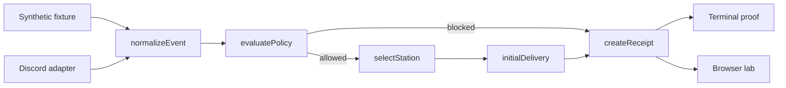

Ambient Relay decides which Discord message a bot would answer, under which policy, and records why, without sending anything. It replays 13 hand-written synthetic messages through a policy gate and three keyword stations, and every message ends as a drafted reply, a draft held for a human, or no reply. The same router runs in a browser lab where you change the policy and watch each decision recompute. A gated Discord adapter exists in code but has never been run against a real Discord account.

<div className="fm-evidence-strip">
  <div className="fm-evidence-cell">
    <span className="fm-proof-label">Status</span>
    <span className="fm-proof-value">Shipped, browser lab on Vercel, synthetic events only</span>
  </div>
  <div className="fm-evidence-cell">
    <span className="fm-proof-label">Runtime</span>
    <span className="fm-proof-value">Node.js 22.13+ standard library, Vite and TypeScript static page, optional discord.js 14</span>
  </div>
  <div className="fm-evidence-cell">
    <span className="fm-proof-label">Try it</span>
    <span className="fm-proof-value"><a href="https://ambient-relay.vercel.app">ambient-relay.vercel.app</a></span>
  </div>
  <div className="fm-evidence-cell">
    <span className="fm-proof-label">Proof hooks</span>
    <span className="fm-proof-value">22 Node tests, checked-in terminal proof with drift check, offline import test, secret scan</span>
  </div>
</div>

## How it works



[`RelayEngine.route`](https://github.com/fortunexbt/ambient-relay/blob/main/src/core/relay-engine.js) runs each event through five fixed stages. [`normalizeEvent`](https://github.com/fortunexbt/ambient-relay/blob/main/src/core/event.js) checks a bounded Discord-shaped envelope. IDs must match `^[A-Za-z0-9_-]{1,64}$`, control characters are stripped, and content must be 1 to 1,000 characters. Anything else throws an `EventValidationError` before routing.

[`evaluatePolicy`](https://github.com/fortunexbt/ambient-relay/blob/main/src/core/policy.js) runs six checks in order and blocks on the first failure. The author must be a person, the message must come from a server rather than a DM, the server and channel must match the allowlist, the mode must be `synthetic`, `discord-observe` or `discord-send`, and the channel's cooldown must have passed. The cooldown is per channel and restarts only when a draft is produced, held drafts included.

[`selectStation`](https://github.com/fortunexbt/ambient-relay/blob/main/src/core/stations.js) scores three stations by keyword hits. Builder takes technical words such as `deploy` and `error`, Care takes words such as `overwhelmed` and `stuck`, and Guide takes question words, a `?` anywhere, and a direct mention. A keyword matches a whole word with an optional `s`, `es`, `ed`, `d` or `ing` ending, so `test` matches `testing` but not `latest`. Ties go to the first station in the order Builder, Care, Guide. A score of zero produces no draft. Each station returns one fixed reply template, and user content never appears in a reply.

`initialDelivery` then picks the delivery state. A draft from a station in `humanReviewStations` (Care by default) is held as `held.human-review` and becomes a `needs-human` receipt in every mode. [`createReceipt`](https://github.com/fortunexbt/ambient-relay/blob/main/src/core/receipt.js) stores SHA-256 fingerprints of the event and the draft plus enumerated codes, never the message or reply text. The receipt ID is the first 16 hex characters of a fingerprint over those fields, so the same input always gives the same ID.

The browser lab bundles `src/core` unchanged. [`vite.config.js`](https://github.com/fortunexbt/ambient-relay/blob/main/vite.config.js) aliases the one `node:crypto` import to [`web/src/node-crypto.js`](https://github.com/fortunexbt/ambient-relay/blob/main/web/src/node-crypto.js), a SHA-256 stand-in built on `@noble/hashes`. A test checks it against Node's own SHA-256. [`web/src/main.ts`](https://github.com/fortunexbt/ambient-relay/blob/main/web/src/main.ts) lets you change three things, the cooldown (off, 60 s or 5 min), the allowlisted channel and which stations need human review, and calls `replayFixture` again on every change. Bot, DM and server checks can't be changed in the lab. The Vercel config sets a content security policy of `connect-src 'self'`.

| File | Role |
| --- | --- |
| [`src/core/event.js`](https://github.com/fortunexbt/ambient-relay/blob/main/src/core/event.js) | Envelope validation and content limits |
| [`src/core/policy.js`](https://github.com/fortunexbt/ambient-relay/blob/main/src/core/policy.js) | Six ordered checks, first failure wins |
| [`src/core/stations.js`](https://github.com/fortunexbt/ambient-relay/blob/main/src/core/stations.js) | Keyword scoring, tie order, fixed reply templates |
| [`src/core/relay-engine.js`](https://github.com/fortunexbt/ambient-relay/blob/main/src/core/relay-engine.js) | Stage order, per-channel cooldown, delivery state, trace |
| [`src/core/receipt.js`](https://github.com/fortunexbt/ambient-relay/blob/main/src/core/receipt.js) | Body-free receipts and receipt revision after delivery |
| [`src/config.js`](https://github.com/fortunexbt/ambient-relay/blob/main/src/config.js) | Synthetic defaults and live-mode configuration checks |
| [`src/live/discord-adapter.js`](https://github.com/fortunexbt/ambient-relay/blob/main/src/live/discord-adapter.js) | Dynamically imported Discord client, reply payload, safe logger |
| [`src/fixtures/discord-events.json`](https://github.com/fortunexbt/ambient-relay/blob/main/src/fixtures/discord-events.json) | The 13 synthetic events |
| [`web/src/main.ts`](https://github.com/fortunexbt/ambient-relay/blob/main/web/src/main.ts) | Browser lab state, policy controls, signal board |
| [`scripts/generate-artifact.js`](https://github.com/fortunexbt/ambient-relay/blob/main/scripts/generate-artifact.js) | Writes or checks the terminal proof |

## The live boundary

[`createRuntimeConfig`](https://github.com/fortunexbt/ambient-relay/blob/main/src/config.js) returns the synthetic config unless `AMBIENT_RELAY_MODE` is set to `discord-observe` or `discord-send`. Live modes need a token of at least 20 characters, a guild and channel ID of 17 to 20 digits, and a cooldown from 1 s to 1 h. Send mode also needs `AMBIENT_RELAY_SEND_ACK` set to `I_ACCEPT_ONE_CHANNEL_SENDS`. There is no fallback. A missing value stops the process with a fixed error code, and the token is stored as a non-enumerable property so it doesn't serialise.

`startDiscordRelay` imports `discord.js` only when the `live` command runs, asks for the Guilds, Guild Messages and Message Content intents, and drops any message outside the exact guild and channel before routing. In send mode `isDeliverable` passes only `drafted` receipts, and `buildDeliveryPayload` sets `allowedMentions` to parse nothing and not ping the replied user. A held draft logs a receipt plus a `reviewUrl` link to the Discord message. Logs are JSON lines on stdout with receipt fields only.

This adapter is an **Experiment**. Its pure functions have unit tests, but the repository's own [`SECURITY.md`](https://github.com/fortunexbt/ambient-relay/blob/main/SECURITY.md) says no account, token, guild, permission set, rate limit or real delivery has been exercised.

## The replay result

The checked-in proof, [`artifacts/demo-session.txt`](https://github.com/fortunexbt/ambient-relay/blob/main/artifacts/demo-session.txt), is the default replay of fixture `relay-room-2026-07@2.0.0`. On 18 November 2026 at `456bcb9` the 13 events ended as follows.

| Outcome | Count | Events |
| --- | ---: | --- |
| Drafted | 3 | `evt-01-deploy` and `evt-10-tie` to Builder, `evt-08-mention` to Guide |
| Held for a human | 2 | `evt-04-overwhelmed` and `evt-13-exhausted` to Care |
| Blocked | 6 | 2 bot authors, 2 cooldowns, 1 DM, 1 channel not allowlisted |
| Observed, no draft | 2 | `evt-05-morning`, `evt-12-lol` |

Outbound messages were 0. These are hand-written events that exercise each rule. They say nothing about how often the stations would pick the right reply on a real server.

## Verify it

These ran on 18 November 2026 against `main` at `456bcb9`, with Node.js 24.18.0.

```bash
gh repo clone fortunexbt/ambient-relay && cd ambient-relay
npm start
```

`npm start` needs no install. It ended with `events 13 ,  drafted 3 ,  needs-human 2 ,  blocked 6 ,  observed 2` and `outbound 0`. `npm run demo:json` prints the same session as JSON.

For the full check, which matches CI:

```bash
npm ci --ignore-scripts
npm run check
npm audit --audit-level=high
```

`npm run check` runs the syntax check, the tests, the artifact drift check, the secret scan and the web build. The tests printed `tests 22`, `pass 22`, `fail 0`. The drift check printed `Terminal proof matches the deterministic replay.` and the scan printed `No high-signal credentials or token-shaped placeholders found.` The audit found 0 vulnerabilities. The [CI run](https://github.com/fortunexbt/ambient-relay/actions/runs/44371585570) on the push of `456bcb9` passed.

The local build produced `index-DHdPIAm4.js` and `index-Dj_DQu-k.css`. The live site served the same two asset names on 18 November 2026, so it runs this commit's lab.

To see the live mode refuse to start without configuration:

```bash
AMBIENT_RELAY_MODE=discord-send node src/cli.js live
```

It printed `Ambient Relay refused to start: config.discord-token-required` and exited with code 1. The live adapter itself was not run for this page.

## Limits

- The stream is 13 hand-written events. The lab can't load messages from your own server and has no Discord client.
- The stations are keyword matchers with fixed templates. They don't read meaning, and nothing measures how often they pick the right station.
- The Discord adapter has never connected to a real account. Rate limits, permissions, login failures and shutdown are untested.
- Care is a fixed acknowledgement template, not a mental-health, moderation or crisis tool. Its drafts are held, and nothing escalates them.
- Cooldown state lives in memory and resets on restart. More than one process would not share it.
- Receipts are stdout lines, not signed or durable records. Fingerprints of short, predictable messages can be guessed.
- The lab's "Off" cooldown is 0 ms. Live mode refuses anything under 1,000 ms.
- The GitHub homepage field links to the v1.0.0 release from 21 July 2026, not to the live site. That release predates the browser lab, and `package.json` still says `1.0.0`.

## Source

- [Repository](https://github.com/fortunexbt/ambient-relay)
- [Live lab](https://ambient-relay.vercel.app)
- [CI workflow](https://github.com/fortunexbt/ambient-relay/actions/workflows/ci.yml)
- [Architecture notes](https://github.com/fortunexbt/ambient-relay/blob/main/ARCHITECTURE.md)
- [Security notes](https://github.com/fortunexbt/ambient-relay/blob/main/SECURITY.md)
- [Runbook](https://github.com/fortunexbt/ambient-relay/blob/main/RUNBOOK.md)
- [Signal board redesign, PR #10](https://github.com/fortunexbt/ambient-relay/pull/10)
- [Release v1.0.0](https://github.com/fortunexbt/ambient-relay/releases/tag/v1.0.0)

Reviewed 18 November 2026 against [`456bcb9`](https://github.com/fortunexbt/ambient-relay/tree/456bcb96511aba22d9d8322ff080d3fc0e090b50).
