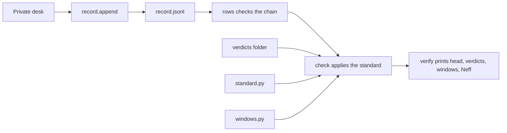

Archon is a strategy desk for Hyperliquid whose public repository holds the rules for listing a strategy and a verifier for its record, not the desk itself. The package `archon_contract` computes the luck-test bar for a given trial count, the probabilistic Sharpe test and the comparison with holding, and checks that an append-only, hash-chained record follows those rules. Its own docstring says it holds "no strategy, data or trading code". The strategy search, evaluator, market data and trading bot behind [archon.quest](https://archon.quest) are not public.

<div className="fm-evidence-strip">
  <div className="fm-evidence-cell">
    <span className="fm-proof-label">Status</span>
    <span className="fm-proof-value">Experiment, public verifier, desk trades on Hyperliquid testnet</span>
  </div>
  <div className="fm-evidence-cell">
    <span className="fm-proof-label">Runtime</span>
    <span className="fm-proof-value">Python 3.10+, standard library only, pytest for tests</span>
  </div>
  <div className="fm-evidence-cell">
    <span className="fm-proof-label">Try it</span>
    <span className="fm-proof-value">`python -m archon_contract demo`, <a href="https://archon.quest">archon.quest</a></span>
  </div>
  <div className="fm-evidence-cell">
    <span className="fm-proof-label">Proof hooks</span>
    <span className="fm-proof-value">45 tests on Python 3.10, 3.12 and 3.13 in CI, tamper demo, no committed trading results</span>
  </div>
</div>

## How it works



The record is one JSONL file. [`record.append`](https://github.com/archonHL/archon/blob/main/src/archon_contract/record.py) writes each line as sorted, compact JSON with a `seq` number and `prev_sha256`, the SHA-256 of the exact bytes of the line before it. `rows` walks the file and stops at the first line whose number, kind or parent hash doesn't match, and it accepts a `genesis` line only as line 1. Editing, deleting, reordering or inserting a line breaks the chain at the next line. The newest line has nothing after it, so the chain proves a copy up to its head and no further.

`check` then replays the record against the standard. A strategy (the code calls it a procedure) must be `register`ed before it is counted, and counted with a `spend` line on a store before a `verdict` on that store. Every `spend` raises the store's Neff, the number of strategies tried there, and the genesis line carries the counts from before the record opened. The `hyperliquid` and `hyperliquid-all` stores share one Neff, so moving a strategy between them can't loosen its bar. For each verdict, `check` confirms the recorded Neff and cut match the store's count at that point, that the S2 pass or fail follows from its p-value, and that R1 follows from its figures at both costs. Given a folder of whole verdicts named by their hashes, it also matches each file to its line and recomputes the p-value from the daily excess series.

[`standard.py`](https://github.com/archonHL/archon/blob/main/src/archon_contract/standard.py) holds the tests themselves. `sidak(neff)` returns the cut `1 - (1 - 0.05)^(1/neff)`, which keeps the chance that pure luck passes any strategy on a store at 5%. `psr_p` is the probabilistic Sharpe ratio of Bailey and Lopez de Prado, with the standard error adjusted for skew and kurtosis, as a one-sided p-value. `r1` requires more return than holding and a shallower worst fall at both 5.5 bps and 8.5 bps a side. `proven` is R1 and a p-value below the cut.

[`windows.py`](https://github.com/archonHL/archon/blob/main/src/archon_contract/windows.py) covers the 50-day forward windows. `opening` starts a window at the first bar close after it is written. `withdraws` returns true when the hosted run's return (the field is `testnet_return_pct`) differs from the replay by more than 2 points, or when the replay falls further than the strategy's worst fall at 8.5 bps. `check` refuses a window written after its first bar, one not exactly 50 days long, a close before the end, a close scored against anything but the strategy's latest verdict, and a `demotion` that doesn't match what `withdraws` says.

| File | Role |
| --- | --- |
| [`src/archon_contract/standard.py`](https://github.com/archonHL/archon/blob/main/src/archon_contract/standard.py) | Fee levels, Sidak cut, probabilistic Sharpe p-value, return and drawdown, R1, Proven |
| [`src/archon_contract/windows.py`](https://github.com/archonHL/archon/blob/main/src/archon_contract/windows.py) | Forward window timing and the withdrawal rule |
| [`src/archon_contract/record.py`](https://github.com/archonHL/archon/blob/main/src/archon_contract/record.py) | Line kinds, chain check, append, verdict and window checks, shared Neff |
| [`src/archon_contract/__main__.py`](https://github.com/archonHL/archon/blob/main/src/archon_contract/__main__.py) | `verify`, `cut` and `demo` commands |
| [`tests/`](https://github.com/archonHL/archon/tree/main/tests) | Planted edges, pure noise, heavy tails, forged and re-chained records, window timing |
| [`docs/standard.md`](https://github.com/archonHL/archon/blob/main/docs/standard.md) | The full standard in prose, including the walk-forward, costs, benchmark and listing tiers |
| [`docs/record.md`](https://github.com/archonHL/archon/blob/main/docs/record.md) | Line kinds and what a copy of the record proves |

## What the code covers and what it doesn't

[`docs/standard.md`](https://github.com/archonHL/archon/blob/main/docs/standard.md) describes more than the code checks. The walk-forward (six-month windows from 1 January and 1 July, at least 365 days of fitting, each test window trading the best setting from the windows before it), the market eligibility rules, funding charges and the buy-and-hold benchmark are all prose. The package receives a verdict's figures and checks that its R1 and S2 follow from them. It does not rebuild the backtest that produced them.

The two listing tiers are also uneven. `proven` is code. The Early tier needs at least 548 tested days, 8 independent bets, a 10% annual return at 8.5 bps, a p-value below 0.05, and no closed forward window that fell as far as holding. Those rules exist only in `docs/standard.md`. The record has no listing line, so `verify` doesn't check which strategies are listed. A `flagship` line is accepted into the chain and not otherwise checked.

## Trading results

The repository commits no trading results. It has no production record, no verdict files and no equity curves, and [`docs/record.md`](https://github.com/archonHL/archon/blob/main/docs/record.md) says the production files are not included. The only figures in the code are the demo's, which are made up (a seeded random series and hard-coded returns), and the tests' fixtures.

The live site shows numbers the public repository can't reproduce. On 18 November 2026 the home page compared the Archon portfolio with holding the same markets, labelled "Tested on past prices, January 2025 to November 2026", which makes it a backtest. The [desk page](https://archon.quest/desk/) showed 38,398 ideas, 493 real tests, 40 strategies on trial and 16 listed, and said the first 50-day trial ends on 24 December. Those trials trade "pretend money against live prices", and the home page says accounts start on the test network. No forward window had closed, so there is no live or paper result yet. This page doesn't repeat the backtest figures because nothing public lets you check them.

## Verify it

These ran on 18 November 2026 against `main` at `181eeec`, with Python 3.15.2:

```bash
git clone https://github.com/archonHL/archon.git && cd archon
python3 -m venv .venv && . .venv/bin/activate
pip install -e '.[test]'
python -m pytest -q
python -m archon_contract demo
python -m archon_contract cut 31
```

`pytest` printed `45 passed in 0.45s`. The demo writes a five-line record, then prints the checks it passes:

```text
chain     5 lines, head 7edf00b7519cd27efcc51c3917beee337e3507e3bd069885bb2e7a41211107a9
verdicts  1 as the standard says, each S2 recomputed from its daily excess
windows   0 closed as opened, 1 open
neff      hyperliquid 3, cut 0.016952
```

It then flips the verdict's R1 from true to false and `verify` refuses with `line 5 is out of sequence or its chain is broken`. It rewrites the whole chain from that line so every hash links again, and `verify` still refuses with `record 4: R1 says False, and its figures at both costs say otherwise`. `cut 31` printed `0.00165325`, the p-value a strategy must beat once 31 have been tried on a store.

The [CI workflow](https://github.com/archonHL/archon/actions/workflows/ci.yml) runs the tests and the demo on Python 3.10, 3.12 and 3.13, and the run for `181eeec` passed.

`python -m archon_contract verify record.jsonl` checks a real record, but no public copy exists to run it on. The record documentation says the site's timeline shows selected fields only, not the full lines needed to recompute each hash.

## Limits

- The public repository is the standard and its verifier. The strategy search, evaluator, walk-forward engine, market data and trading bot are private, so you can't rerun a verdict.
- No production record or verdict file is published, so `verify` can only run on the demo or on records you write yourself.
- The chain proves a copy only up to its head. Nothing anchors the newest line, so dropping recent lines is caught only by comparing with a copy that holds them. The site's docs call the record one "that can't be edited", which goes further than the repository's own [`docs/record.md`](https://github.com/archonHL/archon/blob/main/docs/record.md).
- The walk-forward, benchmark, costs and Early tier are prose in `docs/standard.md`, not code. Listings are not record lines.
- Forward windows and hosted accounts run on Hyperliquid testnet with test USDC. The site's docs say mainnet is switched on per account by Archon.
- The home page's performance figures are a backtest with no public inputs.
- There are no GitHub releases. `pyproject.toml` gives version 2.0.0 and the package isn't on PyPI, so you install it from a clone.

## Source

- [Repository](https://github.com/archonHL/archon)
- [The standard](https://github.com/archonHL/archon/blob/main/docs/standard.md)
- [The record](https://github.com/archonHL/archon/blob/main/docs/record.md)
- [CI workflow](https://github.com/archonHL/archon/actions/workflows/ci.yml)
- [Live site](https://archon.quest)
- [The desk](https://archon.quest/desk/)
- [Site docs, how the engine works](https://archon.quest/docs/engine/)

Reviewed 18 November 2026 against [`181eeec`](https://github.com/archonHL/archon/tree/181eeec1832184bdcd706a3e2cfb4bf57293832a).
