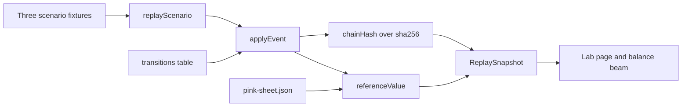

Barter replays three fixed commodity swaps, step by step, through a state machine with an explicit transition table. Each leg is valued at a real World Bank monthly price, and every step extends a SHA-256 hash chain you can recompute with `shasum`. The prices are real. The parties, matching, inspections and settlements are invented fixtures, and nothing moves money, title or goods.

<div className="fm-evidence-strip">
  <div className="fm-evidence-cell">
    <span className="fm-proof-label">Status</span>
    <span className="fm-proof-value">Simulated, static lab live on GitHub Pages</span>
  </div>
  <div className="fm-evidence-cell">
    <span className="fm-proof-label">Runtime</span>
    <span className="fm-proof-value">React 18 and Vite 6 static page, Node.js 20+ to build</span>
  </div>
  <div className="fm-evidence-cell">
    <span className="fm-proof-label">Try it</span>
    <span className="fm-proof-value"><a href="https://fortunexbt.github.io/barter/">fortunexbt.github.io/barter</a></span>
  </div>
  <div className="fm-evidence-cell">
    <span className="fm-proof-label">Proof hooks</span>
    <span className="fm-proof-value">22 engine tests, pinned journal heads, FIPS 180-4 vectors, Pink Sheet extract with workbook SHA-256</span>
  </div>
</div>

## How it works



Everything the lab shows comes from [`demo-engine.ts`](https://github.com/fortunexbt/barter/blob/main/client/src/features/protocol-lab/demo-engine.ts). The `transitions` table lists every legal move between eight states, from `listed` through `matched`, `countered`, `terms_recorded`, `inspection_hold` and `inspection_passed` to the terminal `settled` and `cancelled`. Settlement is reachable only from a passed inspection, and the terminal states accept nothing.

`replayScenario` takes a scenario and a step number. It clamps the step to the journal length, then runs `applyEvent` over the whole journal on every call, not only up to the requested step. So a fixture with a bad event fails at load rather than when you reach it. `applyEvent` throws a `ProtocolRuleError` when a sequence number is out of order, when an event starts from a state other than the current one, when the table doesn't allow the move, or when an amendment appears anywhere but a counter-offer or sets a quantity that isn't positive. Amendments change a leg from that step onward, so stepping back past a counter-offer restores the listed quantity.

Each snapshot carries the derived state, both legs, the value gap between them and the journal head. `referenceValue` multiplies a leg's tonnes by the price from [`reference-prices.ts`](https://github.com/fortunexbt/barter/blob/main/client/src/features/protocol-lab/reference-prices.ts), which converts the $/kg series to $/t. The head starts as SHA-256 of `genesisEntry` (folio, start state, both legs and the price period). `chainHash` then hashes the previous head, a newline and `eventEntry`, which is `sequence|id|from>to` plus `|leg=quantity` for an amendment. [`sha256.ts`](https://github.com/fortunexbt/barter/blob/main/client/src/features/protocol-lab/sha256.ts) is a synchronous implementation, because Web Crypto only offers an async digest and the replay stays a pure function.

The [lab page](https://github.com/fortunexbt/barter/blob/main/client/src/pages/protocol-lab-page.tsx) hangs the two legs from a balance beam that leans 3.5° per 1% of value gap, capped at 8°, so the wheat counter-offer brings it level.

| File | Role |
| --- | --- |
| [`client/src/features/protocol-lab/demo-engine.ts`](https://github.com/fortunexbt/barter/blob/main/client/src/features/protocol-lab/demo-engine.ts) | Transition table, three fixtures, replay, hash chain |
| [`client/src/features/protocol-lab/demo-engine.test.ts`](https://github.com/fortunexbt/barter/blob/main/client/src/features/protocol-lab/demo-engine.test.ts) | Rule, pricing and hash tests |
| [`client/src/features/protocol-lab/sha256.ts`](https://github.com/fortunexbt/barter/blob/main/client/src/features/protocol-lab/sha256.ts) | Synchronous SHA-256 for the browser |
| [`client/src/features/protocol-lab/pink-sheet.json`](https://github.com/fortunexbt/barter/blob/main/client/src/features/protocol-lab/pink-sheet.json) | World Bank extract with workbook URL, SHA-256 and series descriptions |
| [`scripts/extract-pink-sheet.ts`](https://github.com/fortunexbt/barter/blob/main/scripts/extract-pink-sheet.ts) | Downloads the Pink Sheet workbook and rewrites the extract |
| [`client/src/pages/protocol-lab-page.tsx`](https://github.com/fortunexbt/barter/blob/main/client/src/pages/protocol-lab-page.tsx) | Lab page, step controls, balance beam, journal |
| [`client/src/App.tsx`](https://github.com/fortunexbt/barter/blob/main/client/src/App.tsx) | Routes `/`, `/lab` and `/demo` to the lab and lazy-loads the legacy app for everything else |
| [`server/routes.ts`](https://github.com/fortunexbt/barter/blob/main/server/routes.ts) | Express API for the legacy prototype |

## The three journals

| Folio | Exchange | Path | Outcome |
| --- | --- | --- | --- |
| PL-0174-A | 18 t copper cathodes for 35.9 t Arabica coffee | matched, terms recorded, inspection passed | settled |
| PL-0288-B | 1,200 t US HRW wheat for 1,000 t urea | matched, countered to 1,174.4 t, terms recorded, inspection passed | settled |
| PL-0312-C | 40 t cocoa beans for 491.3 t Thai 5% rice | matched, terms recorded, inspection hold | cancelled |

Prices are the September 2026 monthly averages from the World Bank Pink Sheet workbook updated 2 October 2026 (CC BY 4.0), for example copper at $14,474/t and urea at $407.50/t. The tests check that the copper and cocoa pairs are within 0.1% of each other at those prices, that the wheat lot starts 2.2% and $8,900 above the urea, and that 1,174.4 t is the balancing wheat quantity to the nearest 0.1 t. The tests also pin the final journal head of each scenario, so any edit to a fixture or price changes a hash in review.

## Simulated parts

The lab's only real input is the price extract. The "Matching desk", "Inspection desk" and "Clearing desk" are actor names on fixed journal events. No code matches lots, inspects anything or settles anything. The page states that parties, documents and inspection readings are invented.

Every route other than `/`, `/lab` and `/demo` loads a legacy marketplace prototype that needs the Express server. The README labels it a legacy prototype, and its services are simulated too.

- [`smart-contract-service.ts`](https://github.com/fortunexbt/barter/blob/main/server/services/smart-contract-service.ts) "simulates blockchain smart contract functionality". Escrow transaction hashes come from `Math.random`, and no chain is contacted.
- [`zkp-service.ts`](https://github.com/fortunexbt/barter/blob/main/server/services/zkp-service.ts) is a local HMAC challenge-response fixture. Its own comment says it is not a zero-knowledge proof system and must never be treated as KYC.
- The identity endpoint accepts only three named synthetic fixture IDs and rejects any other value. There is no document upload.
- The notifications WebSocket accepts a connection, sends one message and closes it with code 1008.
- Storage is an in-memory adapter unless `DATABASE_URL` points at Postgres.

## Verify it

These ran on 18 November 2026 against `main` at `b5af2b4`, with Node.js 24:

```bash
gh repo clone fortunexbt/barter && cd barter
npm ci
npm audit --omit=dev --audit-level=high
npm run verify
```

The audit printed `found 0 vulnerabilities`. `npm run verify` runs `tsc`, the engine tests and the production build. It printed `tests 22`, `pass 22`, `fail 0` and finished the Vite and esbuild builds with exit code 0. CI runs the same audit and `verify` on Node.js 20 for every push to `main`. The run for `b5af2b4` passed.

To recompute the first two heads of the copper and coffee journal without the repository:

```bash
printf '%s' 'PL-0174-A|listed|offered=copper:18|requested=coffee-arabica:35.9|prices=pink-sheet:2026-09' | shasum -a 256
printf '%s\n%s' 94684eecc27612b0cee840ae503c3924480928abe8a68d8e49f09f4b47035fac '1|copper-coffee-01|listed>matched' | shasum -a 256
```

They printed `94684eecc27612b0cee840ae503c3924480928abe8a68d8e49f09f4b47035fac` and `01e8f4e46d8928a44a7b32b7b68caa195e2891caa0ed051e12d96ec5cde58d28`, which match the README.

To run the lab locally, `npm run dev` starts Express and Vite on port 5000 with no `.env`. Regenerating the price extract (`npm run data:prices -- <workbook URL>`) downloads the World Bank workbook and was not rerun for this page.

## Limits

- The lab replays three fixed journals. You can't enter your own lots, prices or events.
- Prices are monthly benchmark averages for September 2026, not delivered prices for a specific lot, and the extract doesn't update itself.
- Parties, timestamps, evidence references, inspection readings, matching and settlement are fixtures. Nothing moves money, title or goods.
- The legacy prototype behind other routes simulates escrow, blockchain hashes and identity checks. It must not receive real identity documents, funds or keys, and the repository has not been audited for custody, compliance or trading.
- Tests cover the engine only. There is no browser test of the lab page and no test of the legacy server.
- GitHub Pages serves the lab at the site root. The README points to the `/lab` route, but `https://fortunexbt.github.io/barter/lab` doesn't resolve on Pages because the `gh-pages` branch has no fallback page.
- The `gh-pages` branch is published by hand from `main` (its latest commit reads "Publish the protocol lab from main b5af2b4"). No workflow in `main` builds or deploys it.
- `package.json` and the latest GitHub release both say 2.0.0, but that release dates from July 2026. The transition table, Pink Sheet pricing and hash chain landed after it in PR #14, and PR #17 redesigned the page.

## Source

- [Repository](https://github.com/fortunexbt/barter)
- [Live lab](https://fortunexbt.github.io/barter/)
- [CI workflow](https://github.com/fortunexbt/barter/actions/workflows/ci.yml)
- [Transition table, Pink Sheet pricing and hash chain, PR #14](https://github.com/fortunexbt/barter/pull/14)
- [Weighbridge page redesign, PR #17](https://github.com/fortunexbt/barter/pull/17)
- [World Bank Pink Sheet](https://www.worldbank.org/en/research/commodity-markets)

Reviewed 18 November 2026 against [`b5af2b4`](https://github.com/fortunexbt/barter/tree/b5af2b4eec5cff9cae8490ce426c9834e0a9721c).
