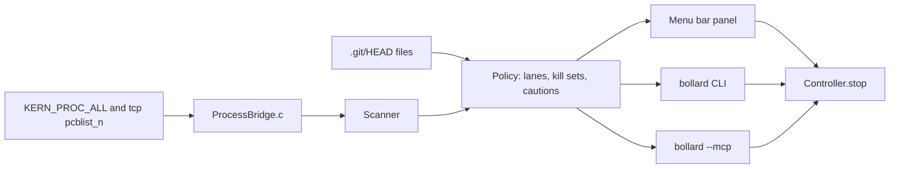

Bollard is a macOS menu bar app that lists every process listening on a TCP port, names each one by its project directory and git branch, and stops it from a row button, a keyboard shortcut, the `bollard` CLI or an MCP tool call. It's for developers whose coding agents leave dev servers running in the background.

<div className="fm-evidence-strip">
  <div className="fm-evidence-cell">
    <span className="fm-proof-label">Status</span>
    <span className="fm-proof-value">Shipped · Homebrew cask, ad-hoc signed, not notarised</span>
  </div>
  <div className="fm-evidence-cell">
    <span className="fm-proof-label">Runtime</span>
    <span className="fm-proof-value">Swift 6 · SwiftUI and AppKit · C bridge to libproc and sysctl · macOS 14+</span>
  </div>
  <div className="fm-evidence-cell">
    <span className="fm-proof-label">Try it</span>
    <span className="fm-proof-value">`brew install --cask fortunexbt/tap/bollard`</span>
  </div>
  <div className="fm-evidence-cell">
    <span className="fm-proof-label">Proof hooks</span>
    <span className="fm-proof-value">19 policy checks in CI, live fixture checks, lsof parity check, scan benchmark JSON</span>
  </div>
</div>

## How it works



Each scan starts in [`ProcessBridge.c`](https://github.com/fortunexbt/bollard/blob/main/Sources/ProcessBridge/ProcessBridge.c). It reads the whole process table with one `sysctl(KERN_PROC_ALL)` call and every TCP socket, with its state, bound address and owning PID, with one `sysctlbyname("net.inet.tcp.pcblist_n")` call. Per-process facts come from libproc: `proc_pidpath`, `proc_pidinfo` for the working directory, `proc_pid_rusage` for memory and CPU, and the descriptor list that confirms a socket's owner the first time Bollard sees it.

[`Scanner.swift`](https://github.com/fortunexbt/bollard/blob/main/Sources/BollardCore/Scanner.swift) caches the executable path and arguments per process generation, so a steady scan only re-reads the two tables and samples the trees it displays. If the socket table can't be parsed, it falls back to `lsof -iTCP -sTCP:LISTEN` and the panel footer says so.

[`Policy.swift`](https://github.com/fortunexbt/bollard/blob/main/Sources/BollardCore/Policy.swift) groups processes into workloads and sorts them into Servers, Background, Apps and System & tools. A workload is named after its root process's working directory. [`Git.swift`](https://github.com/fortunexbt/bollard/blob/main/Sources/BollardCore/Git.swift) walks up from that directory to the nearest `.git`, reads `HEAD` directly (no git binary) and adds the worktree name when `.git` is a `gitdir:` file. Policy also builds each workload's kill set: the root's process tree minus protected processes and their subtrees. Protected means launchd, Bollard itself, other users' processes, macOS system paths, terminals, editors, coding agents, login and session processes, interactive shells and game clients.

[`Controller.swift`](https://github.com/fortunexbt/bollard/blob/main/Sources/BollardCore/Controller.swift) takes a fresh snapshot before it signals anything and re-validates the tree, so new children join the kill set, exited ones drop out and a changed command or owner aborts the stop. Stop sends SIGTERM and waits 4 s, and Force Quit sends SIGKILL and waits 1.5 s. Every signal goes through `proc_signal_with_audittoken` with the start time, unique id and generation read again, so a reused PID is never signalled. A directory declared in `~/Library/Application Support/Bollard/controllers.json` gets its own stop script, which runs only while its SHA-256 matches the declared one ([`Controllers.swift`](https://github.com/fortunexbt/bollard/blob/main/Sources/BollardCore/Controllers.swift)).

The CLI and the MCP server share the same scan and stop path. `bollard --mcp` reads newline-delimited JSON-RPC 2.0 on stdin and answers `initialize`, `tools/list` and `tools/call` for three tools: `list_servers` (optional `query`), `port_owner` (`port`) and `stop_server` (`target` as port, PID or project name, and `signal` as `terminate`, `interrupt` or `kill`).

| File | Role |
| --- | --- |
| [`Sources/ProcessBridge/ProcessBridge.c`](https://github.com/fortunexbt/bollard/blob/main/Sources/ProcessBridge/ProcessBridge.c) | Kernel table reads, libproc calls, audit-token signalling |
| [`Sources/BollardCore/Scanner.swift`](https://github.com/fortunexbt/bollard/blob/main/Sources/BollardCore/Scanner.swift) | Snapshot, per-generation cache, lsof fallback, `launchctl list` labels |
| [`Sources/BollardCore/Policy.swift`](https://github.com/fortunexbt/bollard/blob/main/Sources/BollardCore/Policy.swift) | Workload grouping, lanes, protection rules, kill sets, `validate` |
| [`Sources/BollardCore/Controller.swift`](https://github.com/fortunexbt/bollard/blob/main/Sources/BollardCore/Controller.swift) | Stop, interrupt, force quit, `launchctl bootout`, `brew services stop` |
| [`Sources/BollardCore/Git.swift`](https://github.com/fortunexbt/bollard/blob/main/Sources/BollardCore/Git.swift) | Branch and worktree from `HEAD` files |
| [`Sources/Bollard/MCPServer.swift`](https://github.com/fortunexbt/bollard/blob/main/Sources/Bollard/MCPServer.swift) | MCP server over stdio |
| [`Sources/Bollard/CLI.swift`](https://github.com/fortunexbt/bollard/blob/main/Sources/Bollard/CLI.swift) | `--list`, `--json`, `--stop`, `--interrupt`, `--kill` |
| [`Sources/Bollard/AppDelegate.swift`](https://github.com/fortunexbt/bollard/blob/main/Sources/Bollard/AppDelegate.swift) | Status item, panel, refresh timer |
| [`scripts/build.sh`](https://github.com/fortunexbt/bollard/blob/main/scripts/build.sh) | Universal build, hardened runtime, signing and optional notarisation |

The panel refreshes every 2 s while open and every 30 s while closed. When nothing is running it slows to 4 s open and 120 s closed ([`AppDelegate.swift`](https://github.com/fortunexbt/bollard/blob/main/Sources/Bollard/AppDelegate.swift)). The README gives only the 2 s and 30 s figures.

## Signing and distribution

The 2.1.0 [release](https://github.com/fortunexbt/bollard/releases/tag/v2.1.0) ships `Bollard-2.1.0.dmg` with a universal (arm64 and x86_64) app. [`scripts/build.sh`](https://github.com/fortunexbt/bollard/blob/main/scripts/build.sh) signs with `SIGN_IDENTITY` when it's set and notarises and staples when `NOTARY_PROFILE` is set. Otherwise it signs ad hoc. The released app was signed ad hoc. Mounting the release DMG on 23 October 2026 gave `Signature=adhoc`, flags `adhoc,runtime`, no team identifier and no stapled ticket, and `spctl` rejected it. The README calls the build "signed but not notarized", which holds only for an ad-hoc signature.

The [cask](https://github.com/fortunexbt/homebrew-tap/blob/main/Casks/bollard.rb) in `fortunexbt/homebrew-tap` pins the DMG by SHA-256 (it matches the release asset), links the binary as `bollard`, and runs `xattr -dr com.apple.quarantine` on the app after install so Gatekeeper lets it open. If you install from the DMG by hand, you have to right-click and choose Open, or clear the quarantine flag yourself.

## Scan timings

[`BollardBench`](https://github.com/fortunexbt/bollard/blob/main/Sources/BollardBench/main.swift) runs one first scan, then 15 timed rounds, and prints JSON. The 2.1.0 result is [`docs/performance/scan-2026-10-23-v2.1.json`](https://github.com/fortunexbt/bollard/blob/4268ffef0bcfabedb3aa0ed7ecc1cdbd61e56f6c/docs/performance/scan-2026-10-23-v2.1.json), from a release build on the development Mac with 627 processes and 14 listeners.

| Stage | Median | p95 (the maximum of 15 samples) |
| --- | ---: | ---: |
| Process table, `KERN_PROC_ALL` | 0.24 ms | 0.29 ms |
| Socket table, `pcblist_n` | 0.19 ms | 0.22 ms |
| Policy pass | 2.55 ms | 2.84 ms |
| Steady scan | 4.04 ms | 6.17 ms |
| First scan, including `launchctl list` | 91.3 ms | |

These numbers come from one machine whose model the repository doesn't record. [`VERIFICATION.md`](https://github.com/fortunexbt/bollard/blob/4268ffef0bcfabedb3aa0ed7ecc1cdbd61e56f6c/VERIFICATION.md) puts its load average in the 60s during that run, from other work. With 15 samples the p95 is the slowest sample. The bench measures wall-clock scan cost. It says nothing about energy use or memory growth over time, and no long soak has been run. The [performance notes](https://github.com/fortunexbt/bollard/blob/4268ffef0bcfabedb3aa0ed7ecc1cdbd61e56f6c/docs/performance/README.md) keep the earlier 2.0.0 and 1.1.x runs, which were taken under different load and aren't directly comparable.

## Verify it

These ran on 23 October 2026 against `main` at `4268ffe`:

```bash
gh repo clone fortunexbt/bollard && cd bollard
swift build --build-system native
.build/debug/BollardChecks --policy-only
swift format lint -r Sources Tests Package.swift
```

The build took 1 min 40 s on an Apple Silicon Mac and warned that `--build-system native` is deprecated (CI runs plain `swift build`). The checks printed `19 policy checks passed`, and the lint printed nothing.

To see the MCP server answer without stopping anything:

```bash
printf '%s\n' \
  '{"jsonrpc":"2.0","id":1,"method":"initialize","params":{"protocolVersion":"2025-06-18"}}' \
  '{"jsonrpc":"2.0","id":2,"method":"tools/list"}' \
  | .build/debug/Bollard --mcp
```

It returned `serverInfo` `bollard` `2.1.0` and the tools `list_servers`, `port_owner` and `stop_server`. `.build/debug/Bollard --list` prints a read-only table and a footer with process count, listener count and scan time.

To check the release signature yourself:

```bash
gh release download v2.1.0 -R fortunexbt/bollard -p 'Bollard-2.1.0.dmg'
hdiutil attach -readonly -nobrowse Bollard-2.1.0.dmg
codesign -dv /Volumes/Bollard/Bollard.app
spctl -a -vv -t exec /Volumes/Bollard/Bollard.app
hdiutil detach /Volumes/Bollard
```

The live checks (`.build/debug/BollardChecks` with no flag) start and stop their own Node and Python servers, a launch agent and an app bundle. The socket parity check (`--socket-parity`) compares Bollard's listeners with `lsof`. Neither was run for this page. [`VERIFICATION.md`](https://github.com/fortunexbt/bollard/blob/4268ffef0bcfabedb3aa0ed7ecc1cdbd61e56f6c/VERIFICATION.md) records the author's runs: 12 snapshots and 168 listener comparisons for 2.1.0.

## Limits

- macOS 14 or later only. Discovery reads TCP sockets only, so UDP listeners don't appear, and Docker containers aren't a data source.
- The app is signed ad hoc and not notarised. Gatekeeper rejects it until the quarantine flag is cleared, which the cask does for you.
- It signals only your own user's processes. Other users' ports and system daemons are listed but never signalled, and protected processes inside a tree are left running and flagged.
- The process identity struct comes from Apple's private `proc_info_private.h`. Bollard checks its size and disables actions on a mismatch. The lsof fallback covers a future change to the socket table layout.
- The README's `claude mcp add` example points at `~/.local/bin/bollard`, which only `scripts/install.sh` creates. A cask install puts `bollard` in Homebrew's `bin` instead.
- According to `VERIFICATION.md`, Restart in Terminal, "Claude Code here", `brew services stop`, VoiceOver and Intel hardware haven't been tested.
- The bench comes from one loaded development Mac, and the repository doesn't name its model.

## Source

- [Repository](https://github.com/fortunexbt/bollard)
- [Release 2.1.0](https://github.com/fortunexbt/bollard/releases/tag/v2.1.0)
- [Homebrew cask](https://github.com/fortunexbt/homebrew-tap/blob/main/Casks/bollard.rb)
- [CI workflow](https://github.com/fortunexbt/bollard/actions/workflows/ci.yml)
- [Verification notes](https://github.com/fortunexbt/bollard/blob/main/VERIFICATION.md)
- [Performance notes](https://github.com/fortunexbt/bollard/blob/main/docs/performance/README.md)
- [Changelog](https://github.com/fortunexbt/bollard/blob/main/CHANGELOG.md)

Reviewed 23 October 2026 against [`4268ffe`](https://github.com/fortunexbt/bollard/tree/4268ffef0bcfabedb3aa0ed7ecc1cdbd61e56f6c).
