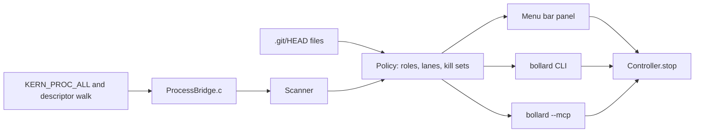

Bollard is a macOS menu bar app that lists every long-lived process tree you own, from dev servers and scripts to coding-agent sessions, names each one by its repository and git branch, and stops it from a row button, a keyboard shortcut, the `bollard` CLI or an MCP tool call. It's for developers whose coding agents leave work running in the background.

<div className="fm-evidence-strip">
  <div className="fm-evidence-cell">
    <span className="fm-proof-label">Status</span>
    <span className="fm-proof-value">Shipped, Homebrew cask, Developer ID signed and notarised</span>
  </div>
  <div className="fm-evidence-cell">
    <span className="fm-proof-label">Runtime</span>
    <span className="fm-proof-value">Swift 6, SwiftUI and AppKit, C bridge to libproc and sysctl, macOS 26+ on Apple silicon</span>
  </div>
  <div className="fm-evidence-cell">
    <span className="fm-proof-label">Try it</span>
    <span className="fm-proof-value">`brew install --cask fortunexbt/tap/bollard`</span>
  </div>
  <div className="fm-evidence-cell">
    <span className="fm-proof-label">Proof hooks</span>
    <span className="fm-proof-value">16 policy checks plus port and binary checks in CI, live fixture checks, lsof parity check, scan benchmark JSON</span>
  </div>
</div>

## How it works



Each scan starts in [`ProcessBridge.c`](https://github.com/fortunexbt/bollard/blob/main/Sources/ProcessBridge/ProcessBridge.c). It reads the whole process table with one `sysctl(KERN_PROC_ALL)` call. Sockets come from `dp_sockets`, which walks the descriptors of every process the user may inspect with `proc_listallpids`, `PROC_PIDLISTFDS` and `PROC_PIDFDSOCKETINFO`. It keeps TCP sockets in LISTEN, bound unconnected UDP sockets and listening Unix-domain sockets. A code comment says macOS 27 withholds the kernel socket table (`net.inet.tcp.pcblist_n`) from apps, so 3.0 removed the table parser and the lsof fallback that 2.1.0 had. Per-process facts come from libproc: `proc_pidpath`, `proc_pidinfo` for the working directory, and `proc_pid_rusage` for memory and CPU. The process that launched a detached process comes from the private `responsibility_get_pid_responsible_for_pid` symbol, looked up with `dlsym`.

[`Scanner.swift`](https://github.com/fortunexbt/bollard/blob/main/Sources/BollardCore/Scanner.swift) caches each process record by PID and start time. It drops the cached record when the kernel's process name changes, and it re-reads the generation of every displayed process so an exec into a program of the same name is caught too. Only displayed workloads are sampled for memory and CPU.

[`Policy.swift`](https://github.com/fortunexbt/bollard/blob/main/Sources/BollardCore/Policy.swift) gives every one of your processes a role: system, session, application, coding agent or your own work. 2.1.0 listed a portless process only when it matched a list of known programs. In 3.0 any tree with the user role is a workload, whatever it runs. A workload without a socket must live 3 s (`settleTime`) before it's listed. [`Program.swift`](https://github.com/fortunexbt/bollard/blob/main/Sources/BollardCore/Program.swift) parses the command line through interpreters, package runners and rewritten process titles, and matches whole names, never substrings. Workloads land in five lanes, Servers, Background, Agents, Apps and System & tools, and the panel adds a Recent lane. [`Git.swift`](https://github.com/fortunexbt/bollard/blob/main/Sources/BollardCore/Git.swift) walks up to the nearest `.git`, reads `HEAD` directly (no git binary) and resolves a linked worktree to its repository's name.

Policy also builds each kill set: the root's process tree minus protected processes and their subtrees. Protected means launchd, Bollard and the processes it runs under, other users' processes, macOS system paths, terminals and editors, login and session processes, interactive shells, full-screen programs in a terminal's foreground, and game clients. For an agent session the kill set is the agent and its direct helpers, such as MCP servers. Servers the agent started through a shell are their own rows and keep running.

[`Controller.swift`](https://github.com/fortunexbt/bollard/blob/main/Sources/BollardCore/Controller.swift) takes a fresh snapshot before it signals anything and re-validates the tree, so new children join the kill set, exited ones drop out and a changed command or owner aborts the stop. Stop sends SIGTERM and waits 4 s, and Force Quit sends SIGKILL and waits 1.5 s. A suspended process gets SIGCONT first. Every signal goes through `proc_signal_with_audittoken` with the start time, unique id and generation read again, so a reused PID is never signalled. A directory declared in `~/Library/Application Support/Bollard/controllers.json` gets its own stop script, which runs only while its SHA-256 matches the declared one ([`Controllers.swift`](https://github.com/fortunexbt/bollard/blob/main/Sources/BollardCore/Controllers.swift)).

The CLI and the MCP server share the same scan and stop path. `bollard --mcp` reads newline-delimited JSON-RPC 2.0 on stdin and answers `initialize`, `ping`, `tools/list` and `tools/call` for five tools.

| Tool | Arguments | Annotations |
| --- | --- | --- |
| `list_servers` | optional `query` | read-only, idempotent |
| `port_owner` | `port` | read-only, idempotent |
| `free_port` | optional `start`, default 3000 | read-only |
| `wait_for_port` | `port`, `state` (`listening` or `free`), `timeout_seconds` capped at 120 | read-only, idempotent |
| `stop_server` | `target` (port, PID or name), `signal` (`terminate`, `interrupt`, `kill`) | destructive |

`free_port` and `wait_for_port` bind and connect to loopback and wildcard addresses in [`Ports.swift`](https://github.com/fortunexbt/bollard/blob/main/Sources/BollardCore/Ports.swift) instead of reading the process list. `stop_server` refuses agent sessions, and `bollard --stop <name>` never matches one by name. Ending a session takes its PID from the CLI or the panel ([`CLI.swift`](https://github.com/fortunexbt/bollard/blob/main/Sources/Bollard/CLI.swift)).

| File | Role |
| --- | --- |
| [`Sources/ProcessBridge/ProcessBridge.c`](https://github.com/fortunexbt/bollard/blob/main/Sources/ProcessBridge/ProcessBridge.c) | Process table, descriptor walk, libproc calls, audit-token signalling |
| [`Sources/BollardCore/Scanner.swift`](https://github.com/fortunexbt/bollard/blob/main/Sources/BollardCore/Scanner.swift) | Snapshot, per-generation cache, exec detection, sampling, `launchctl list` labels |
| [`Sources/BollardCore/Policy.swift`](https://github.com/fortunexbt/bollard/blob/main/Sources/BollardCore/Policy.swift) | Roles, workloads, lanes, protection rules, kill sets, `validate` |
| [`Sources/BollardCore/Program.swift`](https://github.com/fortunexbt/bollard/blob/main/Sources/BollardCore/Program.swift) | Command-line parsing into the program a process runs |
| [`Sources/BollardCore/Controller.swift`](https://github.com/fortunexbt/bollard/blob/main/Sources/BollardCore/Controller.swift) | Stop, interrupt, force quit, `launchctl bootout`, `brew services stop` |
| [`Sources/BollardCore/Ports.swift`](https://github.com/fortunexbt/bollard/blob/main/Sources/BollardCore/Ports.swift) | Free-port and wait-for-port probes |
| [`Sources/BollardCore/Git.swift`](https://github.com/fortunexbt/bollard/blob/main/Sources/BollardCore/Git.swift) | Repository name and branch from `HEAD` files |
| [`Sources/Bollard/MCPServer.swift`](https://github.com/fortunexbt/bollard/blob/main/Sources/Bollard/MCPServer.swift) | MCP server over stdio |
| [`Sources/Bollard/CLI.swift`](https://github.com/fortunexbt/bollard/blob/main/Sources/Bollard/CLI.swift) | `--list`, `--json`, `--stop`, `--interrupt`, `--kill`, `--free-port`, `--wait-port`, `--wait-free` |
| [`Sources/Bollard/AppDelegate.swift`](https://github.com/fortunexbt/bollard/blob/main/Sources/Bollard/AppDelegate.swift) | Status item, panel, refresh timer |
| [`scripts/build.sh`](https://github.com/fortunexbt/bollard/blob/main/scripts/build.sh) | Apple silicon build, hardened runtime, signing and optional notarisation |

The panel refreshes every 2 s while open and every 30 s while closed. When nothing is running it slows to 4 s open and 120 s closed ([`AppDelegate.swift`](https://github.com/fortunexbt/bollard/blob/main/Sources/Bollard/AppDelegate.swift)).

## Signing and distribution

The 3.0.0 [release](https://github.com/fortunexbt/bollard/releases/tag/v3.0.0) ships `Bollard-3.0.0.dmg` with an arm64-only app. [`scripts/build.sh`](https://github.com/fortunexbt/bollard/blob/main/scripts/build.sh) signs with `SIGN_IDENTITY` and a secure timestamp when it's set, notarises and staples when `NOTARY_PROFILE` is set, and signs ad hoc otherwise. The 3.0.0 release was signed with a Developer ID and notarised. On 18 November 2026 both the DMG and the app inside it showed a Developer ID signature with a team identifier, the app carried the hardened runtime flag, `spctl` accepted both as `Notarized Developer ID`, and `stapler validate` succeeded on both. 2.1.0 was signed ad hoc and rejected by `spctl`.

The [cask](https://github.com/fortunexbt/homebrew-tap/blob/main/Casks/bollard.rb) in `fortunexbt/homebrew-tap` pins version 3.0.0 by SHA-256, which matches the release asset. It requires arm64 and macOS Tahoe, links the binary as `bollard`, quits the app on uninstall and lists two paths for `zap`. It no longer clears the quarantine flag, since a notarised app doesn't need it. The README asks for `brew trust --cask fortunexbt/tap/bollard` once per machine before install, because Homebrew 7 loads casks only from official or trusted taps.

## Scan timings

[`BollardBench`](https://github.com/fortunexbt/bollard/blob/main/Sources/BollardBench/main.swift) runs one first scan, then 15 timed rounds, and prints JSON. The 3.0.0 result is [`docs/performance/scan-2026-11-18.json`](https://github.com/fortunexbt/bollard/blob/8da12827d55491cf7beff56e70d209276612b6f1/docs/performance/scan-2026-11-18.json), a release build on macOS 27.2 with 788 processes, 25 sockets and 14 workloads. A rerun for this page used a fresh release build on a Mac16,1 under a load average near 9.5, with 1,019 processes, 36 sockets and 36 workloads.

| Stage | Repository median | Repository p95 | Rerun median | Rerun p95 |
| --- | ---: | ---: | ---: | ---: |
| Process table, `KERN_PROC_ALL` | 0.16 ms | 0.28 ms | 0.48 ms | 1.93 ms |
| Socket walk (TCP, UDP, Unix) | 1.50 ms | 1.72 ms | 5.62 ms | 6.91 ms |
| Policy pass | 5.96 ms | 6.23 ms | 24.4 ms | 26.9 ms |
| Steady scan | 9.06 ms | 9.88 ms | 33.5 ms | 71.5 ms |
| First scan, including `launchctl list` | 110.7 ms | | 170.4 ms | |

With 15 samples the p95 is the slowest sample. The repository doesn't record the machine model or load for its run. The rerun had about 30% more processes and 2.6 times the workloads, and its steady scan was 3.7 times slower, so scan cost grows with how much is running and with load. The policy pass is the largest stage in both runs. `VERIFICATION.md` says policy isn't optimised further. The steady scan is also slower than the earlier socket-walk build's 2.9 ms in the [performance notes](https://github.com/fortunexbt/bollard/blob/8da12827d55491cf7beff56e70d209276612b6f1/docs/performance/README.md), which attribute the difference to every process now getting a role and a parsed command line. The bench measures wall-clock scan cost. It says nothing about energy use or memory growth over time, and no long soak has been run.

## Verify it

These ran on 18 November 2026 against `main` at `8da1282`, the commit tagged `v3.0.0`:

```bash
gh repo clone fortunexbt/bollard && cd bollard
swift build
.build/debug/BollardChecks --policy-only
swift format lint -r Sources Tests Package.swift
```

The debug build took 29 s on an Apple Silicon Mac. The checks printed `Port checks passed: busy, listening, wait, first free, freed, out of range`, `Binary checks passed: --free-port, --wait-port timeout, MCP initialize, tools, calls` and `16 policy checks passed`. The lint printed nothing. CI runs the same three steps and passed on `8da1282`.

To see the MCP server answer without stopping anything:

```bash
printf '%s\n' \
  '{"jsonrpc":"2.0","id":1,"method":"initialize","params":{"protocolVersion":"2025-06-18"}}' \
  '{"jsonrpc":"2.0","id":2,"method":"tools/list"}' \
  | .build/debug/Bollard --mcp
```

It returned `serverInfo` `bollard` `3.0.0`, echoed protocol `2025-06-18`, and listed `list_servers`, `port_owner`, `free_port`, `wait_for_port` and `stop_server` with the annotations in the table above. With no `protocolVersion` in the request, it answered `2025-11-25`. `.build/debug/Bollard --list` prints a read-only table and a footer with process count, listener count and scan time. On the review Mac it listed 34 rows across the Servers, Background, Agents and System & tools lanes. `--json` returned the same 34 rows with keys including `runs`, `sockets`, `provenance` and `url`.

To reproduce the timings:

```bash
swift build -c release --product BollardBench
.build/release/BollardBench
```

To check the release signature yourself:

```bash
gh release download v3.0.0 -R fortunexbt/bollard -p 'Bollard-3.0.0.dmg'
shasum -a 256 Bollard-3.0.0.dmg
hdiutil attach -readonly -nobrowse Bollard-3.0.0.dmg
codesign -dv /Volumes/Bollard/Bollard.app
spctl -a -vv -t exec /Volumes/Bollard/Bollard.app
xcrun stapler validate /Volumes/Bollard/Bollard.app
hdiutil detach /Volumes/Bollard
```

The SHA-256 printed `20f5f042…01870cad`, the same value the cask pins. On macOS 27.2, `hdiutil` warns that `attach` and `detach` are deprecated in favour of `diskutil image attach` and `diskutil eject`, and still works.

The live checks (`.build/debug/BollardChecks` with no flag) start and stop their own Node and Python servers, a launch agent and an app bundle, and compare the descriptor walk with `lsof`. They weren't run for this page. [`VERIFICATION.md`](https://github.com/fortunexbt/bollard/blob/8da12827d55491cf7beff56e70d209276612b6f1/VERIFICATION.md) records the author's 3.0.0 runs: 12 rounds of `lsof` parity with about 120 listener comparisons, the live fixtures, and a lab of 13 processes started from a Claude Code shell where 3.0.0 listed all 11 that stayed up.

## Limits

- macOS 26 or later on Apple silicon only. The author couldn't test on macOS 26, so 3.0.0 was verified on macOS 27.2 only. Intel Macs aren't supported.
- The descriptor walk sees only your own processes, like `lsof` run as you. Root's and other users' sockets don't appear. `port_owner` says when a port is held by a process Bollard can't inspect.
- `free_port` and `wait_for_port` probe loopback and wildcard addresses only, so a server bound only to a LAN address isn't seen. `wait_for_port` waits at most 120 s.
- It signals only your own user's processes. System daemons are listed but never signalled, and protected processes inside a tree are left running and flagged. The MCP server never ends an agent session.
- The process identity struct comes from Apple's private `proc_info_private.h`, and launcher attribution uses a private symbol. Bollard checks the struct's size and disables actions on a mismatch. With the lsof fallback gone, the descriptor walk is the only socket source.
- The README says the MCP server "speaks protocol 2025-06-18". The code supports four versions and defaults to `2025-11-25` when the client names none.
- `VERIFICATION.md` and the performance notes compare against a 2.2.0 build. No 2.2.0 release or changelog entry exists.
- The README's `claude mcp add` example points at `~/.local/bin/bollard`, which only `scripts/install.sh` creates. A cask install puts `bollard` in Homebrew's `bin` instead.
- According to `VERIFICATION.md`, Restart in Terminal, "Claude Code Here", `brew services stop`, VoiceOver, Increase Contrast and Reduce Transparency weren't tested for 3.0.0.
- Scan cost depends on how much is running. The repository's 9 ms steady scan came from one unnamed Mac, and the rerun here took 33.5 ms with more processes and higher load.

## Source

- [Repository](https://github.com/fortunexbt/bollard)
- [Release 3.0.0](https://github.com/fortunexbt/bollard/releases/tag/v3.0.0)
- [Homebrew cask](https://github.com/fortunexbt/homebrew-tap/blob/main/Casks/bollard.rb)
- [CI workflow](https://github.com/fortunexbt/bollard/actions/workflows/ci.yml)
- [Verification notes](https://github.com/fortunexbt/bollard/blob/main/VERIFICATION.md)
- [Performance notes](https://github.com/fortunexbt/bollard/blob/main/docs/performance/README.md)
- [Changelog](https://github.com/fortunexbt/bollard/blob/main/CHANGELOG.md)

Reviewed 18 November 2026 against [`8da1282`](https://github.com/fortunexbt/bollard/tree/8da12827d55491cf7beff56e70d209276612b6f1).
