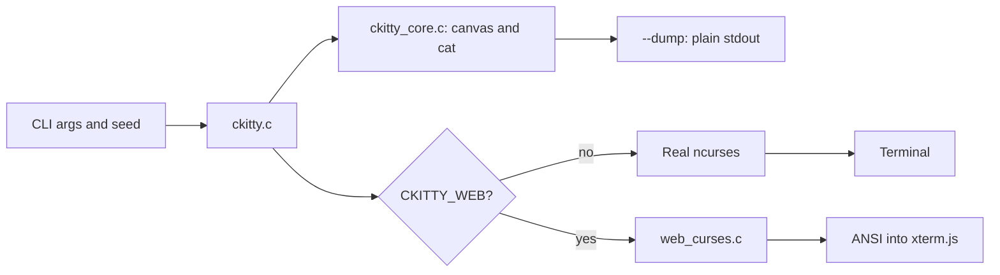

ckitty is a C11 program that draws an animated ASCII cat in your terminal, in four poses and three palettes. The same C code, compiled to WebAssembly, runs in the browser at [ckitty.vercel.app](https://ckitty.vercel.app), and `--dump` prints one seeded frame without starting ncurses.

<div className="fm-evidence-strip">
  <div className="fm-evidence-cell">
    <span className="fm-proof-label">Status</span>
    <span className="fm-proof-value">Shipped · v1.1.0 binaries and web build</span>
  </div>
  <div className="fm-evidence-cell">
    <span className="fm-proof-label">Runtime</span>
    <span className="fm-proof-value">C11 · ncurses · libm · 65 KB wasm in the browser</span>
  </div>
  <div className="fm-evidence-cell">
    <span className="fm-proof-label">Try it</span>
    <span className="fm-proof-value">[ckitty.vercel.app](https://ckitty.vercel.app)</span>
  </div>
  <div className="fm-evidence-cell">
    <span className="fm-proof-label">Proof hooks</span>
    <span className="fm-proof-value">`--dump --seed`, `make check`, `make sanitize`</span>
  </div>
</div>

## How it works



[`src/ckitty_core.c`](https://github.com/fortunexbt/ckitty/blob/main/src/ckitty_core.c) has no terminal code. It seeds a small RNG, picks a cat's pose and coat variations with `ckitty_kitty_randomize`, and draws a frame into a character canvas with `ckitty_render_frame(kitty, frame, canvas)`. The frame number drives blinks, ear twitches, the tail swish and walking steps, so the same seed, pose, frame and canvas size always give the same characters.

[`src/ckitty.c`](https://github.com/fortunexbt/ckitty/blob/main/src/ckitty.c) parses options with `getopt_long`. With `--dump`, it builds an 80×24 canvas (or `--width` by `--height`), renders frame 0 (or `--frame`), prints the canvas trimmed to its bounding box, and exits before it would call `initscr()`. Otherwise it runs the ncurses loop: input with a timeout, layout, palettes, help, pause, the live reveal (`-l`) and the screensaver (`-S`).

The file picks its curses at compile time. Under `#ifdef CKITTY_WEB` it includes [`src/web_curses.h`](https://github.com/fortunexbt/ckitty/blob/main/src/web_curses.h), and otherwise `<ncurses.h>`. Only `make web` compiles the shim. The native build links `-lncurses -lm` on macOS and `-lncursesw -lm` on Linux, and the Makefile finds Homebrew's keg-only ncurses through `brew --prefix ncurses`.

[`src/web_curses.c`](https://github.com/fortunexbt/ckitty/blob/main/src/web_curses.c) implements the curses calls `ckitty.c` uses (`initscr`, `getch`, `mvaddch`, `addnwstr`, `init_pair`, `refresh` and a few more) on top of a cell grid. `refresh()` flushes the grid as ANSI to the page through an `EM_JS` hook. `getch()` waits in `emscripten_sleep` slices, which Asyncify turns into yields to the browser event loop, and returns keys the page queued with the exported `ckitty_web_key`. `make web` compiles `ckitty.c`, `ckitty_core.c` and `web_curses.c` with `emcc -O3 -sASYNCIFY -DCKITTY_WEB` into `web/public/ckitty.js` and `ckitty.wasm`. Both are committed, with the xterm.js dist, so the [Vercel config](https://github.com/fortunexbt/ckitty/blob/main/vercel.json) serves `web/public` as static files with no build step. [`web/public/ckitty-page.js`](https://github.com/fortunexbt/ckitty/blob/main/web/public/ckitty-page.js) starts the program with `--live`, or with no flags when the viewer prefers reduced motion.

| File | Role |
|---|---|
| [`src/ckitty_core.c`](https://github.com/fortunexbt/ckitty/blob/main/src/ckitty_core.c), [`.h`](https://github.com/fortunexbt/ckitty/blob/main/src/ckitty_core.h) | RNG, canvas, cat generation, frame rendering, draw order for the reveal |
| [`src/ckitty.c`](https://github.com/fortunexbt/ckitty/blob/main/src/ckitty.c) | CLI, `--dump`, ncurses loop, curses selected by `CKITTY_WEB` |
| [`src/web_curses.c`](https://github.com/fortunexbt/ckitty/blob/main/src/web_curses.c), [`.h`](https://github.com/fortunexbt/ckitty/blob/main/src/web_curses.h) | Curses subset for the WebAssembly build |
| [`Makefile`](https://github.com/fortunexbt/ckitty/blob/main/Makefile) | `all`, `check`, `sanitize`, `web`, `demo`, `install` |
| [`install.sh`](https://github.com/fortunexbt/ckitty/blob/main/install.sh) | Builds, runs `make check`, installs under `--prefix`, never calls `sudo` |
| [`tests/test_ckitty_core.c`](https://github.com/fortunexbt/ckitty/blob/main/tests/test_ckitty_core.c) | Core renderer tests |
| [`tests/test_cli.sh`](https://github.com/fortunexbt/ckitty/blob/main/tests/test_cli.sh) | Option parsing and `--dump` checks |
| [`tests/test_resize.py`](https://github.com/fortunexbt/ckitty/blob/main/tests/test_resize.py) | Drives the ncurses UI in a pseudo-terminal: keys, palettes, Unicode messages, resizes |
| [`tests/test_web_keys.mjs`](https://github.com/fortunexbt/ckitty/blob/main/tests/test_web_keys.mjs) | Playwright check that keys reach the web build after a click (`make test-web`, outside `make check`) |
| [`tools/make-demo.sh`](https://github.com/fortunexbt/ckitty/blob/main/tools/make-demo.sh) | Builds the README GIF from real `--dump` frames |

## Verify it

These ran on 23 October 2026 at commit [`cd7d1fb`](https://github.com/fortunexbt/ckitty/tree/cd7d1fb328a6901c13ab2ded7716800e7a712d15) on macOS with Homebrew ncurses.

```bash
git clone https://github.com/fortunexbt/ckitty.git
cd ckitty
make && make check
./ckitty --dump --seed 123 sit
make sanitize
```

`make check` printed `OK` (core tests), `CLI OK`, and `TERMINAL OK (controls, palettes, Unicode messages, compact help, quiet, pause/help, slow timing, live progress, screensaver, resizes)`. `make sanitize` rebuilt with AddressSanitizer and UndefinedBehaviorSanitizer and printed the same three lines. The dump printed an 8-line, 120-byte sitting cat, and two runs compared equal with `cmp`. `./ckitty --version` printed `ckitty 1.1.0`.

With Emscripten 6.0.13 installed, `make web WEB_OUT=/tmp/ck/ckitty.js` produced a 65,023-byte `ckitty.wasm` that was byte-identical to the committed [`web/public/ckitty.wasm`](https://github.com/fortunexbt/ckitty/blob/main/web/public/ckitty.wasm). The Playwright key test was not run.

The [Build and Test workflow](https://github.com/fortunexbt/ckitty/blob/main/.github/workflows/build.yml) runs `make check` on Ubuntu and macOS, a headless `--dump` check, and `make sanitize` on Ubuntu. The [Release workflow](https://github.com/fortunexbt/ckitty/blob/main/.github/workflows/release.yml) runs `make check` on each tag and attaches `linux-x86_64` and `macos-arm64` tarballs with SHA-256 files.

## Limits

- Building needs a C11 compiler, wide-character ncurses and libm. Sanitizer support depends on the compiler.
- There is no Homebrew formula. The `fortunexbt/homebrew-tap` repo holds only a cask for another project. Install with `install.sh`, from source, or from a release tarball.
- Release binaries cover Linux x86_64 and Apple silicon only. v1.1.0 (8 September 2026) predates the web build, so the WebAssembly code exists only on `main`.
- `--dump` repeats for a given seed, pose, frame and size. Interactive animation timing depends on terminal input and the clock.
- The browser build leaves out the screensaver loop, `--message`, `NO_COLOR` and piping `--dump`, according to the README.
- GPL-3.0. Redistributed binaries carry its source and notice obligations.

## Source

- [Repository](https://github.com/fortunexbt/ckitty)
- [Live browser build](https://ckitty.vercel.app)
- [Releases](https://github.com/fortunexbt/ckitty/releases), latest [v1.1.0](https://github.com/fortunexbt/ckitty/releases/tag/v1.1.0)
- [Build and Test runs](https://github.com/fortunexbt/ckitty/actions/workflows/build.yml)
- [Project structure notes](https://github.com/fortunexbt/ckitty/blob/main/docs/PROJECT_STRUCTURE.md)

<Card title="Prove a kitty repeats" icon="repeat-2" href="/recipes/ckitty-deterministic-frame" horizontal>
  Render the same seeded frame twice, compare it byte for byte, and run the native checks.
</Card>
