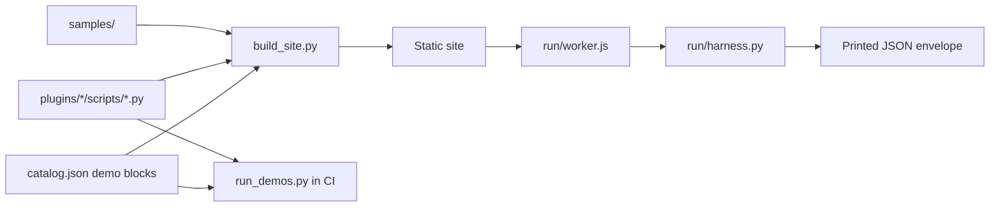

Fieldwork is a set of eight plugins for ChatGPT and Codex. Each one wraps a single-file Python CLI behind a `SKILL.md`, so the agent runs a bounded command that prints JSON instead of improvising. The catalog site downloads the same scripts, runs them in Pyodide on committed public inputs, and prints what each tool prints. The tools cover Minecraft frame captures, video size caps, exact CSV aggregates, release checks, file tidying, CAD drawings, GitHub Actions spend and glTF budgets.

<div className="fm-evidence-strip">
  <div className="fm-evidence-cell">
    <span className="fm-proof-label">Status</span>
    <span className="fm-proof-value">Shipped, catalog live on Vercel, not in the OpenAI plugin directory</span>
  </div>
  <div className="fm-evidence-cell">
    <span className="fm-proof-label">Runtime</span>
    <span className="fm-proof-value">Python 3.11+ CLIs, Pyodide 314.0.7 in a module worker, static site</span>
  </div>
  <div className="fm-evidence-cell">
    <span className="fm-proof-label">Try it</span>
    <span className="fm-proof-value"><a href="https://fieldwork-plugins.vercel.app">fieldwork-plugins.vercel.app</a></span>
  </div>
  <div className="fm-evidence-cell">
    <span className="fm-proof-label">Proof hooks</span>
    <span className="fm-proof-value">80 unit tests, eight catalog demos run against the real tools, ZIP smoke from clean extraction</span>
  </div>
</div>

## How it works



Each plugin lives in `plugins/<name>/` with a portable `plugin.json`, a Codex manifest in `.codex-plugin/`, and a skill directory holding `SKILL.md` and one script. The `SKILL.md` tells the agent which subcommand to run and how to translate a request into its arguments. [`tablebeam.py`](https://github.com/fortunexbt/fieldwork-plugins/blob/main/plugins/tablebeam/skills/tablebeam/scripts/tablebeam.py), for example, takes a JSON spec with `where`, `group_by` and `aggregate`, and its skill tells the agent to ask rather than guess when a column is ambiguous. Seven of the scripts use only the standard library. CAD Rescue needs `ezdxf` and Fit to Upload calls `ffmpeg` and `ffprobe`.

Every command prints one JSON envelope with `status`, `summary`, `data` and `warnings`. Inputs are explicit paths, and output files must not already exist. Safe Tidy, for example, writes plans and receipts with `O_CREAT | O_EXCL` and moves a file by linking it into place before it unlinks the original (`_move_link_then_unlink`).

[`build_site.py`](https://github.com/fortunexbt/fieldwork-plugins/blob/main/scripts/build_site.py) copies `site/`, each plugin's icon and CLI, and every demo input into `.artifacts/site`, and inlines `catalog.json` into `index.html`. In the browser, [`worker.js`](https://github.com/fortunexbt/fieldwork-plugins/blob/main/site/run/worker.js) loads Pyodide 314.0.7 from jsDelivr in a module worker, writes the sample inputs into `/work`, fetches the tool's script and runs each step of the demo. [`harness.py`](https://github.com/fortunexbt/fieldwork-plugins/blob/main/site/run/harness.py) compiles the script once and executes it as `__main__` with the demo's argv, capturing stdout, stderr, exit code and run time.

The browser lacks three things the tools use, and `harness.py` substitutes each one per run.

- `install_link_fallback` replaces `os.link` with an exclusive create and a byte copy. The copy doesn't share an inode, so Safe Tidy's `apply` refuses to run and its demo stops at the plan.
- `XhrOpener` routes ShipProof's HTTP request through a blocking `XMLHttpRequest`.
- `prepare` replays recorded `ffprobe` and `ffmpeg` output for Fit to Upload from `recorded-binaries.json`. The byte budget is still computed live from that metadata.

[`run_demos.py`](https://github.com/fortunexbt/fieldwork-plugins/blob/main/scripts/run_demos.py) runs the same demo steps with a local interpreter. It fails when a tool exits non-zero, prints non-JSON, reports `error`, omits a value the site displays, or skips a file the demo promises. It also checks that the recorded `ffprobe` size matches the committed clip.

| File | Role |
| --- | --- |
| [`catalog.json`](https://github.com/fortunexbt/fieldwork-plugins/blob/main/catalog.json) | Plugin metadata and each demo's inputs, argv and displayed values |
| [`plugins/`](https://github.com/fortunexbt/fieldwork-plugins/tree/main/plugins) | Eight plugins, each with manifests, `SKILL.md` and one script |
| [`site/run/worker.js`](https://github.com/fortunexbt/fieldwork-plugins/blob/main/site/run/worker.js) | Boots Pyodide, writes inputs, runs demo steps one at a time |
| [`site/run/harness.py`](https://github.com/fortunexbt/fieldwork-plugins/blob/main/site/run/harness.py) | Executes a CLI as `__main__`, link, socket and FFmpeg substitutes |
| [`scripts/run_demos.py`](https://github.com/fortunexbt/fieldwork-plugins/blob/main/scripts/run_demos.py) | Runs every catalog demo against the real scripts |
| [`scripts/release.py`](https://github.com/fortunexbt/fieldwork-plugins/blob/main/scripts/release.py) | Generates metadata, validates plugins, builds one ZIP per plugin with `SHA256SUMS` |
| [`scripts/smoke_archives.py`](https://github.com/fortunexbt/fieldwork-plugins/blob/main/scripts/smoke_archives.py) | Extracts each ZIP to a temporary directory and runs its CLI |
| [`scripts/build_site.py`](https://github.com/fortunexbt/fieldwork-plugins/blob/main/scripts/build_site.py) | Assembles the static catalog site |
| [`.github/workflows/ci.yml`](https://github.com/fortunexbt/fieldwork-plugins/blob/main/.github/workflows/ci.yml) | Tests on Python 3.11 and 3.13, demos, lint, metadata, packaging |

## Hosting

The site is on Vercel at [fieldwork-plugins.vercel.app](https://fieldwork-plugins.vercel.app), built by [`vercel.json`](https://github.com/fortunexbt/fieldwork-plugins/blob/main/vercel.json) with `python3 scripts/build_site.py --output .artifacts/site`. No workflow in the repository deploys to Vercel. The [Pages workflow](https://github.com/fortunexbt/fieldwork-plugins/blob/main/.github/workflows/pages.yml) publishes the same build to [fortunexbt.github.io/fieldwork-plugins](https://fortunexbt.github.io/fieldwork-plugins/) on each push to `main`. On 18 November 2026 both answered `HTTP/2 200`, and both had been modified at 18:41 UTC, the minute PR #2 merged.

The README links the Vercel URL. The repository homepage, `catalog.json` and every plugin manifest's website, support, privacy and terms URLs still point at the GitHub Pages copy.

## Verify it

These ran on 18 November 2026 against `main` at `16470b5`, with Python 3.11 on an Apple Silicon Mac:

```bash
gh repo clone fortunexbt/fieldwork-plugins && cd fieldwork-plugins
python3.11 -m venv .venv && . .venv/bin/activate
python -m pip install -r requirements-dev.txt -r plugins/cad-rescue/skills/cad-rescue/requirements.txt
python -m unittest discover -s tests
python scripts/run_demos.py
```

The unit tests printed `Ran 80 tests in 15.714s` and `OK (skipped=2)`. `ffmpeg` and `rsvg-convert` were installed, so the Fit to Upload and CAD Rescue preview tests ran. `run_demos.py` printed `ok` for all eight plugins in 1.5 s. The release ZIP build and archive smoke weren't run for this page. CI runs them on every push. The 3.13 job of the CI run for `16470b5` passed, and the 3.11 job was still running when this page was written.

To run one tool by hand:

```bash
python3 plugins/frame-lab/skills/frame-lab/scripts/frame_lab.py inspect \
  --evidence-dir samples/minecraft-capture --run mmc-r12-112954-0
```

It returned `status` `needs_attention` with `valid` `false` and the reason `Missing route completion sidecar.` It still measured the capture: 10,569 frame intervals, 502.6 average FPS, a 15.71 ms p99 frame time and a 53.5 fps 1% low. The Tablebeam example in the README (`query samples/tablebeam/penguins.csv --spec samples/tablebeam/penguins-query.json`) returned the mean body mass per species over 342 rows as exact decimals, such as `3700.662251655629139072847682119205` for Adelie.

## Limits

- The plugins aren't in the OpenAI plugin directory. The README says submission waits on developer identity verification. There are no GitHub releases, so you install from the repository or build the ZIPs with `scripts/release.py build`.
- The catalog site doesn't run everything for real. Fit to Upload replays recorded FFmpeg output, and Safe Tidy stops at its plan because the browser filesystem has no hard links.
- ShipProof's demo and `run_demos.py` fetch from jsDelivr, so they need network access.
- Two unit tests skip unless you supply a real DWG file and LibreDWG runtime, or raw Minecraft captures. DWG support in CAD Rescue depends on that optional runtime.
- Frame Lab measures CPU frame-production intervals, not GPU or display latency. Asset Check checks budgets and missing resources and doesn't measure frame rate.
- The Frame Lab demo capture can't be ranked because its harness writes `route.csv`, not the `route.json` sidecar Frame Lab expects. The site shows that rejection on purpose.
- The Vercel deployment has no workflow in the repository, so it can drift from `main` unless it's redeployed.
- CAD Rescue is GPL-3.0-only. The rest of the repository is MIT.

## Source

- [Repository](https://github.com/fortunexbt/fieldwork-plugins)
- [Live catalog](https://fieldwork-plugins.vercel.app)
- [CI workflow](https://github.com/fortunexbt/fieldwork-plugins/actions/workflows/ci.yml)
- [Pages workflow](https://github.com/fortunexbt/fieldwork-plugins/actions/workflows/pages.yml)
- [PR #2, catalog redesign](https://github.com/fortunexbt/fieldwork-plugins/pull/2)
- [Third-party notices](https://github.com/fortunexbt/fieldwork-plugins/blob/main/THIRD_PARTY_NOTICES.md)

Reviewed 18 November 2026 against [`16470b5`](https://github.com/fortunexbt/fieldwork-plugins/tree/16470b54fc64b0314470b87d5782ae782fcdca2d).
