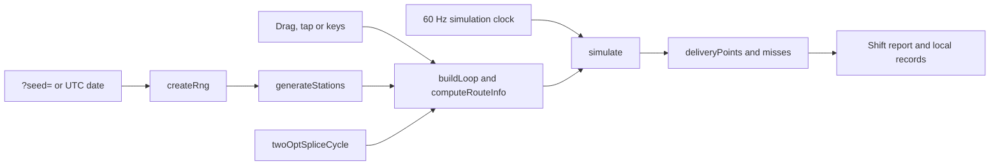

Loop Courier is a browser game. You draw one closed delivery route through a city of 12 stations, dispatch a courier and keep parcels moving for a two-minute shift, with three chances to rewire the route mid-run. The city comes from a seed, so a shared link gives a friend the same map, and the default city changes every midnight UTC.

<div className="fm-evidence-strip">
  <div className="fm-evidence-cell">
    <span className="fm-proof-label">Status</span>
    <span className="fm-proof-value">Shipped · GitHub Pages and Vercel</span>
  </div>
  <div className="fm-evidence-cell">
    <span className="fm-proof-label">Runtime</span>
    <span className="fm-proof-value">Plain JavaScript modules · Canvas · no runtime dependencies</span>
  </div>
  <div className="fm-evidence-cell">
    <span className="fm-proof-label">Try it</span>
    <span className="fm-proof-value">[fortunexbt.github.io/loop-courier](https://fortunexbt.github.io/loop-courier/)</span>
  </div>
  <div className="fm-evidence-cell">
    <span className="fm-proof-label">Proof hooks</span>
    <span className="fm-proof-value">25 Node tests, four Playwright suites in Chromium and WebKit, frame-rate replay parity</span>
  </div>
</div>

## How it works



On load, [`main.js`](https://github.com/fortunexbt/loop-courier/blob/main/main.js) reads `?seed=` from the URL. Without one it uses `dailySeed()` from [`progression.js`](https://github.com/fortunexbt/loop-courier/blob/main/progression.js), which is today's UTC date as `YYYY-MM-DD`. [`game-core.js`](https://github.com/fortunexbt/loop-courier/blob/main/game-core.js) hashes the string with `xmur3` into a `mulberry32` generator. `generateStations` then places two pickups (circles) and two dropoffs (squares) for each of red, blue and gold, at least 70 px apart when a free spot turns up within 800 tries.

You build the route by dragging, tapping stations or using the arrow keys and `Space`. `computeRouteInfo` marks a station as covered when the loop passes near it. A color becomes a live contract when the route covers at least one pickup and one dropoff of that color. The **Dispatch courier** button stays disabled until the loop is closed and holds at least one contract.

During the shift the courier follows the loop and carries up to three parcels. Orders appear only at covered pickups of contracted colors. [`economy.js`](https://github.com/fortunexbt/loop-courier/blob/main/economy.js) sets the numbers:

- An order spawns every `8000 ms × accel / √(covered pickups)` plus jitter, where `accel` falls from 1 to 0.55 as difficulty rises.
- A delivery pays `30 + 35 × (contract colors − 1)`, multiplied by `1 + 0.12 × min(12, combo)`.
- A missed deadline costs 18 points and resets the combo.

Deadlines start at about 21 seconds and shrink, with an 8-second floor, as difficulty climbs from 1 to 7 over the shift. Traffic jams slow the courier and toll zones subtract score (`hazardEffectsAtPoint`). **Splice route** runs `twoOptSpliceCycle`: it cuts two non-adjacent edges and reconnects the loop, and it is refused if the new route would lose every contract. You get three splices per shift.

[`simulation-clock.js`](https://github.com/fortunexbt/loop-courier/blob/main/simulation-clock.js) advances the game in fixed 1/60-second ticks however long each animation frame took. The game's clock, `nowMs()`, is the tick count, so a seeded run with the same inputs reaches the same state at any frame rate.

`main.js` keeps two test hooks, `window.render_game_to_text` and `window.advanceTime`, between `// test-hooks:start` and `// test-hooks:end` markers. [`scripts/build-site.mjs`](https://github.com/fortunexbt/loop-courier/blob/main/scripts/build-site.mjs) copies the static files into `site/` and strips that block from `main.js`. Both GitHub Pages and Vercel ([`vercel.json`](https://github.com/fortunexbt/loop-courier/blob/main/vercel.json)) serve `site/`.

| File | Role |
| --- | --- |
| [`main.js`](https://github.com/fortunexbt/loop-courier/blob/main/main.js) | Input, route state, shift simulation, rendering, share, test hooks |
| [`game-core.js`](https://github.com/fortunexbt/loop-courier/blob/main/game-core.js) | Seeded RNG, station layout, loop geometry, 2-opt splice, hazard effects |
| [`economy.js`](https://github.com/fortunexbt/loop-courier/blob/main/economy.js) | Spawn rate, delivery payout, miss penalty |
| [`simulation-clock.js`](https://github.com/fortunexbt/loop-courier/blob/main/simulation-clock.js) | Fixed 60 Hz tick clock |
| [`progression.js`](https://github.com/fortunexbt/loop-courier/blob/main/progression.js) | Daily seed, per-city personal bests (30 cities), ranks |
| [`scripts/build-site.mjs`](https://github.com/fortunexbt/loop-courier/blob/main/scripts/build-site.mjs), [`scripts/strip-test-hooks.mjs`](https://github.com/fortunexbt/loop-courier/blob/main/scripts/strip-test-hooks.mjs) | Production build without test hooks |
| [`scripts/replay-smoke.mjs`](https://github.com/fortunexbt/loop-courier/blob/main/scripts/replay-smoke.mjs) | Frame-rate replay parity in a real browser |

## Route economy check

An October 2026 review found that a three-station triangle through one pickup and one dropoff outscored a route through the whole city, while the in-game tip said "Connect more colors for a delivery bonus." [PR #7](https://github.com/fortunexbt/loop-courier/pull/7), merged through [PR #5](https://github.com/fortunexbt/loop-courier/pull/5), moved the numbers into `economy.js`, scaled order spawns by covered pickups and paid more for each extra color.

[`tests/economy.test.js`](https://github.com/fortunexbt/loop-courier/blob/c703b97e5d0591d0b7f68fcadbf3f08fb5e32ee1/tests/economy.test.js) checks the result. For each of 10 seeds it builds the shortest one-color triangle and a nearest-neighbour tour of all 12 stations improved with 2-opt. It runs each for 120 seconds in a simplified model of the shift and asserts that the full loop scores more than 1.25 times the triangle. The cities are generated from seeds, so there is no external data. At commit [`c703b97`](https://github.com/fortunexbt/loop-courier/tree/c703b97e5d0591d0b7f68fcadbf3f08fb5e32ee1), on the 10 test seeds plus `METRO-7`, the full loop scored 1.43 to 3.27 times the triangle, from 1,646 against 1,153 on `2026-10-24` to 3,766 against 1,153 on `METRO-7`.

The model is a reimplementation inside the test file, not the game's `simulate()`. It uses the same spawn, payout, deadline and courier-speed formulas but leaves out jams, tolls and splices, and it steps in 50 ms increments. It shows that the formulas favor coverage. It does not prove the shipped game plays out the same way.

The in-game guide and the route panel now say that a loop covering more stations draws more orders and each extra color pays more. The README's "More coverage, or a faster lap?" section still suggests starting with one connection and treats coverage as a tradeoff.

## Verify it

```bash
git clone https://github.com/fortunexbt/loop-courier.git
cd loop-courier
npm ci
npm run verify
```

`npm run verify` runs `node --check` on the game modules and scripts and then runs the Node test suite. It needs Node.js 22 or newer. On 23 October 2026, at commit `c703b97`, it printed `tests 25`, `pass 25`, `fail 0`.

For the browser suites, install a Playwright browser, start the source server and run them from a second terminal:

```bash
npx playwright install chromium webkit
PORT=4189 npm run dev
npm run test:browser
LOOP_COURIER_BROWSER=webkit npm run test:browser
```

Both engines passed. The replay suite printed `Replay parity: METRO-7, 1314 points, same at 30/144 fps and with stalls.`, with 3186 points for `CONTROL-9` and 1092 for `2026-09-08`. [CI](https://github.com/fortunexbt/loop-courier/actions/workflows/ci.yml) runs the same suites in Chromium and WebKit on every push.

To confirm the production bundle has no test hooks:

```bash
npm run build
grep -c "render_game_to_text\|advanceTime" site/main.js
```

It prints `0`. On 23 October 2026 the `main.js` served by both live sites was byte-identical to this build.

## Limits

- The browser suites need the test hooks, so they run against the source files from `npm run dev`. No browser test runs the stripped `site/` bundle.
- The route economy test uses its own simplified model of a shift, not the game's simulation. See [Route economy check](#route-economy-check).
- A seed reproduces the city, orders and hazards. It doesn't carry your route or inputs, so two players on one seed compete only by comparing scores by hand.
- Personal bests live in `localStorage` for the 30 most recently played cities. There is no account and no online leaderboard.
- The daily city follows the UTC date, so it changes at 00:00 UTC whatever your time zone.
- The only GitHub release is v1.0.0 from July 2026. `package.json` still says `1.0.0`, and the changelog lists the September and October work under Unreleased.

## Source

- [Repository](https://github.com/fortunexbt/loop-courier)
- [Live game on GitHub Pages](https://fortunexbt.github.io/loop-courier/)
- [Live game on Vercel](https://loop-courier-game.vercel.app/)
- [CI workflow](https://github.com/fortunexbt/loop-courier/actions/workflows/ci.yml)
- [Pages workflow](https://github.com/fortunexbt/loop-courier/actions/workflows/pages.yml)
- [Changelog](https://github.com/fortunexbt/loop-courier/blob/main/CHANGELOG.md)
