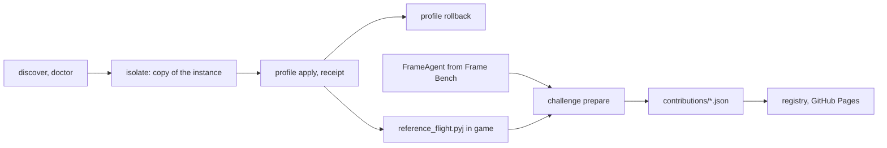

Silicon Shader is a Python CLI and a static website of Minecraft Java shader setups for Apple Silicon Macs. Each setup has a recipe, a screenshot and frame timings from one scripted flight over a fixed seeded world. It's for Mac players on Fabric, Sodium and Iris who want to try a shader look in a separate copy of their game and keep or revert it.

<div className="fm-evidence-strip">
  <div className="fm-evidence-cell">
    <span className="fm-proof-label">Status</span>
    <span className="fm-proof-value">Shipped · GitHub Pages library and Python CLI</span>
  </div>
  <div className="fm-evidence-cell">
    <span className="fm-proof-label">Runtime</span>
    <span className="fm-proof-value">Python 3.10+, no dependencies · Java agent from Frame Bench · Minecraft 26.3</span>
  </div>
  <div className="fm-evidence-cell">
    <span className="fm-proof-label">Try it</span>
    <span className="fm-proof-value">[Browse setups](https://fortunexbt.github.io/minecraft-apple-silicon-framework/)</span>
  </div>
  <div className="fm-evidence-cell">
    <span className="fm-proof-label">Proof hooks</span>
    <span className="fm-proof-value">Per-frame intervals in every contribution, recomputed by CI · 93 unit tests</span>
  </div>
</div>

## How it works



The CLI entry point is [`silicon_shader/cli.py`](https://github.com/fortunexbt/minecraft-apple-silicon-framework/blob/main/silicon_shader/cli.py). `discover` and `doctor` read the Mac and a Prism instance (or any game directory with `--game-dir`) and never launch the game. `isolate` copies a closed instance to a new destination and refuses existing destinations and symlinked content. It doesn't copy accounts, logs or launcher hooks.

`profile apply` in [`instances.py`](https://github.com/fortunexbt/minecraft-apple-silicon-framework/blob/main/silicon_shader/instances.py) works only on that managed copy. It saves every file it will touch, writes a receipt with each file's hash before and after, and reverts on error. `profile rollback RECEIPT_ID` restores the saved files and refuses if a file has changed since the apply. The writer covers game, Iris and render-scale settings. It doesn't install shader packs or mods, and it leaves the graphics backend and window mode alone. `daily` makes a clean copy with the measurement agent and Minescript stripped out.

Timing happens inside the running game. A Java agent hooks the return of `Minecraft.renderFrame(boolean)` and records `System.nanoTime()` once per frame. A Minescript script, [`reference_flight.pyj`](https://github.com/fortunexbt/minecraft-apple-silicon-framework/blob/main/workloads/overworld-v1/reference_flight.pyj), checks the world's seed and generator, sets FOV 70 and clear noon, waits through 30 s standing still, then flies a fixed 420-tick route with a turn, about 21 s, and records the camera pose, focus and timing as it goes. `challenge route-receipt` checks those observations against the pinned route in [`overworld-v1.json`](https://github.com/fortunexbt/minecraft-apple-silicon-framework/blob/main/silicon_shader/workloads/overworld-v1.json). `challenge prepare` then ties each receipt to its frame CSV and builds a bundle with one baseline run and one candidate run.

Accepted bundles live in [`contributions/`](https://github.com/fortunexbt/minecraft-apple-silicon-framework/tree/main/contributions), named by the SHA-256 of their content. The [Challenge site workflow](https://github.com/fortunexbt/minecraft-apple-silicon-framework/blob/main/.github/workflows/pages.yml) runs [`registry.py`](https://github.com/fortunexbt/minecraft-apple-silicon-framework/blob/main/silicon_shader/registry.py) on every push to `main`. It validates each bundle, recomputes its metrics and writes `site/data.json`, which [`site/app.js`](https://github.com/fortunexbt/minecraft-apple-silicon-framework/blob/main/site/app.js) renders as filterable cards. A pull request that adds only a valid current-route bundle is merged by the [Challenge evidence workflow](https://github.com/fortunexbt/minecraft-apple-silicon-framework/blob/main/.github/workflows/challenge.yml). Recipe and code changes still need review.

| File | Role |
| --- | --- |
| [`silicon_shader/instances.py`](https://github.com/fortunexbt/minecraft-apple-silicon-framework/blob/main/silicon_shader/instances.py) | `isolate`, receipt-backed `profile apply` and `rollback`, `daily` |
| [`silicon_shader/measure.py`](https://github.com/fortunexbt/minecraft-apple-silicon-framework/blob/main/silicon_shader/measure.py) | CSV reader, metric definitions, capture gates |
| [`silicon_shader/challenge.py`](https://github.com/fortunexbt/minecraft-apple-silicon-framework/blob/main/silicon_shader/challenge.py) | Bundle preparation and validation, content digest |
| [`silicon_shader/workloads/overworld-v1.json`](https://github.com/fortunexbt/minecraft-apple-silicon-framework/blob/main/silicon_shader/workloads/overworld-v1.json) | Seed, route poses, tolerances, portrait camera |
| [`workloads/overworld-v1/reference_flight.pyj`](https://github.com/fortunexbt/minecraft-apple-silicon-framework/blob/main/workloads/overworld-v1/reference_flight.pyj) | In-game flight runner |
| [`recipes/m4-wide24/sampler/`](https://github.com/fortunexbt/minecraft-apple-silicon-framework/tree/main/recipes/m4-wide24/sampler) | Frame Bench agent copy and `import_capture.py` used by the current route |
| [`silicon_shader/registry.py`](https://github.com/fortunexbt/minecraft-apple-silicon-framework/blob/main/silicon_shader/registry.py) | Builds `site/data.json` from `contributions/` |

## How Frame Bench fits in

[Minecraft Frame Bench](https://github.com/fortunexbt/minecraft-frame-bench) is the standalone timing harness the measurements came from. Its [`FrameAgent.java`](https://github.com/fortunexbt/minecraft-frame-bench/blob/main/src/FrameAgent.java) is a `-javaagent` that uses ASM to hook `renderFrame(boolean)`, or `runTick(boolean)` if that method is missing. It buffers timestamps, checks window focus and writes `frame,nanotime,interval_ns` CSV after the capture. The agent refuses to arm while Minecraft's inactive-FPS policy is AFK, because scripted movement doesn't reset the idle timer and the client drops to 30 FPS after a minute. Frame Bench also ships Minescript pan and movement routes, a [`capture.py`](https://github.com/fortunexbt/minecraft-frame-bench/blob/main/scripts/capture.py) driver that waits for at least 75% CPU idle and no new swap-outs, and [`summarize.py`](https://github.com/fortunexbt/minecraft-frame-bench/blob/main/scripts/summarize.py). It contains no measurement data.

Silicon Shader keeps a copy of that agent in [`recipes/m4-wide24/sampler/`](https://github.com/fortunexbt/minecraft-apple-silicon-framework/tree/main/recipes/m4-wide24/sampler), and the [current workload guide](https://github.com/fortunexbt/minecraft-apple-silicon-framework/blob/main/workloads/overworld-v1/README.md) names it as the 26.3 adapter. The copy differs from Frame Bench `main` in a few lines: `FrameSink.requestStop()` ends the capture on the next frame once the route finishes, so the last slow interval is kept, and the error field resets between captures. Every published bundle records its harness as `FrameBench-campaign-v1`. The repository's other sampler, [`sampler/`](https://github.com/fortunexbt/minecraft-apple-silicon-framework/blob/main/sampler/README.md), is a generic agent configured by `hook.properties`. It has a different completion format, and the current route doesn't use it.

## Published measurements

All four current-route setups were measured on one base M4 MacBook Pro (10 CPU cores, 10 GPU cores, 24 GiB), Minecraft 26.3, Fabric 0.19.5, Java 25, with a 120 FPS cap and vsync off. Three bundles record AC power, and Clear Water 24 records none. Each card is one pair: a baseline flight with the M4 Wide View settings (MakeUp Ultra Fast, 24 chunks, 60% render scale) and a candidate flight with the new setup, each from its own launch. The Far Horizon, Vibrant 16 and Max 32 recipes say the first flight of each launch was dropped as warm-up and name the later flight that was kept. The Clear Water 24 recipe doesn't say which flight it used.

[`measure.py`](https://github.com/fortunexbt/minecraft-apple-silicon-framework/blob/main/silicon_shader/measure.py) defines the numbers. Average FPS is the interval count times 1000 divided by the summed interval milliseconds. Worst five seconds is the lowest frame rate over any window of consecutive intervals that adds up to at least 5 s. Candidate figures at commit [`66be124`](https://github.com/fortunexbt/minecraft-apple-silicon-framework/tree/66be124820e3c71dd7e6c133b9fb47e36b536cb1/contributions):

| Setup | Output, scale, chunks | Average FPS | Worst 5 s | p99 frame | Baseline average | Bundle |
| --- | --- | ---: | ---: | ---: | ---: | --- |
| M4 Far Horizon | 3024x1898, 0.5, 10 + Distant Horizons 256 | 98.35 | 92.81 | 13.81 ms | 108.97 | [`2b95d43a`](https://github.com/fortunexbt/minecraft-apple-silicon-framework/blob/66be124820e3c71dd7e6c133b9fb47e36b536cb1/contributions/2b95d43aae2ca482321bf2026e0c0a7237baa4fa8c94916eb5eb7498c12b877b.json) |
| M4 Vibrant 16 | 3024x1898, 0.6, 16 | 99.82 | 90.33 | 12.53 ms | 107.23 | [`6b58f501`](https://github.com/fortunexbt/minecraft-apple-silicon-framework/blob/66be124820e3c71dd7e6c133b9fb47e36b536cb1/contributions/6b58f5016d5de47e1551eab549bfb5f2a5226d7782738c198fa0781d30faf1e8.json) |
| M4 Max 32 | 3024x1898, 0.5, 32 | 98.49 | 88.91 | 12.46 ms | 109.15 | [`809f46ec`](https://github.com/fortunexbt/minecraft-apple-silicon-framework/blob/66be124820e3c71dd7e6c133b9fb47e36b536cb1/contributions/809f46ec986c0aae8b21ff8ad35a91b61970a71b48eae922ba47d5bf9f70da27.json) |
| M4 Clear Water 24 | 3024x1964, 0.6, 24 | 99.76 | 90.32 | 12.70 ms | 101.78 | [`2ca24ee4`](https://github.com/fortunexbt/minecraft-apple-silicon-framework/blob/66be124820e3c71dd7e6c133b9fb47e36b536cb1/contributions/2ca24ee4244309c8e1ad05274358db7314fddec96cb813738b109777b9ce32a2.json) |

Each bundle file holds the full list of frame intervals for both runs (about 2,070 to 2,290 per flight), the SHA-256 of each original CSV, both route receipts and the settings. The bundles keep relative intervals and leave out absolute timestamps and private paths. Recomputing the metrics from those intervals with `measure.analyze` gives the stored values and the README table. The fifth card, M4 Wide View, used an earlier 21 s camera pan in a desert village. The site lists it under earlier routes, apart from the current four.

The numbers show how quickly the game's main thread finished frames on this one Mac, over one 21 s flight per side, for settings recorded in the bundle. Every candidate is slower than its baseline, since each one buys a different look, a longer view or stronger reflections with frame rate.

They don't show these things:

- GPU time, displayed frames, input latency or generated frames. The hook times CPU frame production, limiter waits included.
- Any Mac other than the base M4. The [hardware inventory](https://github.com/fortunexbt/minecraft-apple-silicon-framework/blob/main/docs/HARDWARE.md) lists every released model, and none of the others has a result.
- Variance. Each figure is one flight. The recipes report neighbouring flights within about 1 to 3 FPS, and the README treats gaps under 5 FPS as ties. In the Far Horizon recipe the discarded warm-up flight (100.9 FPS) was faster than the kept one.
- Equal image quality. Render scale, view distance, shader pack and window mode differ between cards, and Clear Water 24 ran in exclusive fullscreen at a taller output.
- Rates above the 120 FPS cap.
- World generation or all-day play. Terrain is generated before timing, and inventory, building and save/reload are separate manual checks.
- Tamper-proof results. Bundles are self-reported. CI checks consistency, but it can't confirm that a run happened.

## Verify it

These ran on 23 October 2026 against `main` at `66be124`, without launching Minecraft:

```bash
gh repo clone fortunexbt/minecraft-apple-silicon-framework
cd minecraft-apple-silicon-framework
python3 -m unittest discover -s tests
python3 -m silicon_shader.registry contributions /tmp/silicon-shader-data.json
python3 -m silicon_shader challenge workload
```

The tests printed `Ran 93 tests` and `OK` in about 6 s. The registry printed `{"entries": 5, ...}`, and `challenge workload` printed the pinned route (seed `20260929`, 420 client ticks, start `-121.3 100 438.7`).

To recompute the candidate figures from the published intervals:

```bash
python3 - <<'EOF'
import json, glob
from silicon_shader.measure import analyze
for f in sorted(glob.glob('contributions/*.json')):
    e = json.load(open(f))
    c = analyze(e['bundle']['runs']['candidate']['intervals_ms'])
    print(e['bundle']['metadata']['workload']['route'], f"{c['average_fps']:.2f}", f"{c['worst_5s_fps']:.2f}")
EOF
```

The four `silicon-shader-overworld-v1` lines match the table above, and the `cosine-pan-90-21s` line is the earlier-route card. `./sampler/smoke.sh` builds the generic sampler (it downloads ASM 9.10.1 and needs a JDK) and runs it against a stub fixture. It passed, and it proves the file protocol only.

For Frame Bench, the build runs its AFK policy test before it packages the agent:

```bash
gh repo clone fortunexbt/minecraft-frame-bench && cd minecraft-frame-bench
curl -sSfLo asm.jar https://repo.maven.apache.org/maven2/org/ow2/asm/asm/9.10.1/asm-9.10.1.jar
python3 build.py --jdk "$(/usr/libexec/java_home)" --asm "$PWD/asm.jar"
```

With JDK 25 it printed `Live policy regression checks passed (including latent AFK rejection).` and the hashes of `frame-agent.jar`, `frame-sink.jar` and, on macOS, the `controller` input helper. The agent's manifest embeds the absolute path of `asm.jar`, so build on the machine that will run it. No game capture was run for this page.

## Limits

- Minecraft Java 26.x on Apple Silicon only, ideally through Prism. Bedrock, Intel Macs, iPhone, iPad and Windows aren't covered.
- The CLI doesn't launch Minecraft, download mods or shaders, or upload anything. You install those from their publishers, and the repository redistributes no game, shader or mod files.
- Automatic measurement needs an agent that can send chat commands, press F2 and keep the window focused, plus macOS Accessibility permission. With shell access alone, a setup gets reported as unmeasured.
- The timing hook is tied to the Minecraft version. Frame Bench has mappings for 26.2 and 26.3, and the current route requires 26.3.
- All current results come from one machine, and the author recorded them. No outside submission exists yet.
- The site is a static GitHub Pages build with no backend. Entries are self-reported.

## Source

- [Repository](https://github.com/fortunexbt/minecraft-apple-silicon-framework)
- [Live library](https://fortunexbt.github.io/minecraft-apple-silicon-framework/)
- [Workload definition](https://github.com/fortunexbt/minecraft-apple-silicon-framework/blob/main/docs/WORKLOAD.md)
- [Fixtures CI](https://github.com/fortunexbt/minecraft-apple-silicon-framework/actions/workflows/test.yml)
- [Challenge site workflow](https://github.com/fortunexbt/minecraft-apple-silicon-framework/actions/workflows/pages.yml)
- [Campaign notes](https://github.com/fortunexbt/minecraft-apple-silicon-framework/blob/main/docs/EXPERIMENTS.md)
- [Minecraft Frame Bench](https://github.com/fortunexbt/minecraft-frame-bench) and its [CI](https://github.com/fortunexbt/minecraft-frame-bench/actions/workflows/ci.yml)

Reviewed 23 October 2026 against [`66be124`](https://github.com/fortunexbt/minecraft-apple-silicon-framework/tree/66be124820e3c71dd7e6c133b9fb47e36b536cb1) and Frame Bench [`9742471`](https://github.com/fortunexbt/minecraft-frame-bench/tree/97424710e488346b1304e59dd3d39e42a731f166).
