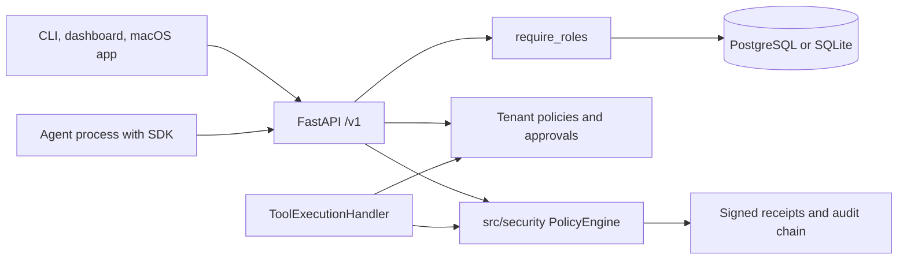

MUTX is a FastAPI service that stores agents, deployments, runs, policies and approvals per user, with a Next.js dashboard, an Electron macOS app, a Click CLI and a Python SDK in front of it. It's for teams that run agents in their own processes and want one place to register them, record what they did and check tool calls against rules before they execute.

<div className="fm-evidence-strip">
  <div className="fm-evidence-cell">
    <span className="fm-proof-label">Status</span>
    <span className="fm-proof-value">Shipped · v1.4.0 source, hosted service offline</span>
  </div>
  <div className="fm-evidence-cell">
    <span className="fm-proof-label">Runtime</span>
    <span className="fm-proof-value">Python 3.11 · FastAPI · SQLAlchemy on PostgreSQL or SQLite · Next.js 16 · Electron</span>
  </div>
  <div className="fm-evidence-cell">
    <span className="fm-proof-label">Try it</span>
    <span className="fm-proof-value">Local API on SQLite, no account · [recipe](/recipes/mutx-operator-loop)</span>
  </div>
  <div className="fm-evidence-cell">
    <span className="fm-proof-label">Proof hooks</span>
    <span className="fm-proof-value">2,897 collected pytest tests, ruff, AgentDojo policy replay</span>
  </div>
</div>

## How it works



[`src/api/main.py`](https://github.com/mutx-dev/mutx-dev/blob/main/src/api/main.py) builds the app. Importing it at `5ad48f0` gives 251 routes: 246 under `/v1` and the root probes `/`, `/health`, `/ready`, `/metrics` and `/release`. On startup it creates tables, starts a background agent monitor and a scheduler loop, and leaves the document and reasoning workers off unless configured. SQLite works with one process (`WEB_CONCURRENCY=1`); [`src/api/config.py`](https://github.com/mutx-dev/mutx-dev/blob/main/src/api/config.py) rejects it in production.

Routes that read or change a user's data check roles through `require_roles` in [`src/api/auth/dependencies.py`](https://github.com/mutx-dev/mutx-dev/blob/main/src/api/auth/dependencies.py). Roles live in the database. [`User.roles`](https://github.com/mutx-dev/mutx-dev/blob/main/src/api/models/models.py) defaults to `["VIEWER"]`, and signup, SSO and the localhost-only `/v1/auth/local-bootstrap` all create viewers. Creating agents or policies needs `DEVELOPER`, and reading audit events needs `ADMIN` or `AUDIT_ADMIN`. No route grants a role, so on a fresh install someone has to write the role into the `users` table.

Agents don't run inside the API. In [`src/api/routes/agents.py`](https://github.com/mutx-dev/mutx-dev/blob/main/src/api/routes/agents.py), `POST /v1/agents/{id}/deploy` writes a `Deployment` row and sets the agent to `running`, and `POST /v1/agents/{id}/stop` marks the agent and its deployments `stopped`. The agent itself is a separate process. [`sdk/mutx/agent_runtime.py`](https://github.com/mutx-dev/mutx-dev/blob/main/sdk/mutx/agent_runtime.py) registers it, sends heartbeats, metrics and logs, and polls `GET /v1/agents/commands` ([`src/api/routes/agent_runtime.py`](https://github.com/mutx-dev/mutx-dev/blob/main/src/api/routes/agent_runtime.py)). Runs are records a client posts after the fact. There are two stores: `POST /v1/runs` with its traces ([`src/api/routes/runs.py`](https://github.com/mutx-dev/mutx-dev/blob/main/src/api/routes/runs.py)), and `/v1/observability/runs`, which the SDK's [`observability.py`](https://github.com/mutx-dev/mutx-dev/blob/main/sdk/mutx/observability.py) and `mutx observability runs` use. A run posted to one doesn't show up in the other.

Policy is checked in two places. Tenant policies in [`src/api/services/policy_store.py`](https://github.com/mutx-dev/mutx-dev/blob/main/src/api/services/policy_store.py) are named rule lists. Each rule has a type (`block`, `allow` or `warn`), a glob or substring pattern, and a scope (`input`, `output` or `tool`). `POST /v1/policies/evaluate` matches every enabled rule and returns `block` if any block rule matched, then `require_approval`, then `warn`, else `allow`. The governed runtime in [`src/security/`](https://github.com/mutx-dev/mutx-dev/tree/main/src/security) has its own `PolicyEngine` with `allow`, `deny`, `modify` and `defer`, signs each decision into an Ed25519 receipt and links receipts into a per-session hash chain ([`docs/governed-runtime-spec.md`](https://github.com/mutx-dev/mutx-dev/blob/main/docs/governed-runtime-spec.md)). `POST /v1/security/actions/evaluate` runs that engine as a dry run and stores the signed receipt.

The two meet in `ToolExecutionHandler.execute_tool` in [`src/api/services/agent_runtime.py`](https://github.com/mutx-dev/mutx-dev/blob/main/src/api/services/agent_runtime.py). It asks the governed runtime first, then the tenant policies through `evaluate_with_approval` ([`src/api/services/policy_approval.py`](https://github.com/mutx-dev/mutx-dev/blob/main/src/api/services/policy_approval.py)). A deferred call runs only after it consumes a matching approved request, and the handler blocks the call if the approval lookup fails. This handler serves LangChain agents built by `AgentRuntime.create_agent`. No route in `src/api/routes/` calls `AgentRuntime` at `5ad48f0`, so the only way to exercise this path is to embed the runtime in your own code.

| File | Role |
| --- | --- |
| [`src/api/main.py`](https://github.com/mutx-dev/mutx-dev/blob/main/src/api/main.py) | App factory, router mounting, probes, startup workers |
| [`src/api/auth/dependencies.py`](https://github.com/mutx-dev/mutx-dev/blob/main/src/api/auth/dependencies.py) | `require_roles`, token and API-key users |
| [`src/api/routes/agents.py`](https://github.com/mutx-dev/mutx-dev/blob/main/src/api/routes/agents.py) | Agent create, deploy and stop as database state |
| [`src/api/routes/agent_runtime.py`](https://github.com/mutx-dev/mutx-dev/blob/main/src/api/routes/agent_runtime.py) | Register, heartbeat, metrics, logs and command polling for agent processes |
| [`src/api/services/policy_store.py`](https://github.com/mutx-dev/mutx-dev/blob/main/src/api/services/policy_store.py) | Tenant policy rules and evaluation |
| [`src/api/services/policy_approval.py`](https://github.com/mutx-dev/mutx-dev/blob/main/src/api/services/policy_approval.py) | Policy decision to durable approval request |
| [`src/api/services/agent_runtime.py`](https://github.com/mutx-dev/mutx-dev/blob/main/src/api/services/agent_runtime.py) | In-process LangChain runtime and governed tool execution |
| [`src/security/`](https://github.com/mutx-dev/mutx-dev/tree/main/src/security) | `PolicyEngine`, approvals, receipts, `AuditChain`, offline verifier |
| [`cli/main.py`](https://github.com/mutx-dev/mutx-dev/blob/main/cli/main.py) | `mutx` command groups, including `setup`, `doctor`, `agents`, `observability` |
| [`app/dashboard/`](https://github.com/mutx-dev/mutx-dev/tree/main/app/dashboard) | Next.js operator dashboard |
| [`desktop/main.cjs`](https://github.com/mutx-dev/mutx-dev/blob/main/desktop/main.cjs) | Electron shell for the macOS app |

The CLI's `mutx setup local` reuses an API already answering on `localhost:8000`. Otherwise it runs `scripts/dev.sh up` with Docker, from the current checkout or from a managed checkout under `~/.mutx/runtime/local-control` ([`cli/local_control_plane.py`](https://github.com/mutx-dev/mutx-dev/blob/main/cli/local_control_plane.py)). Either way it then installs or imports OpenClaw, the only provider it accepts ([`cli/commands/setup.py`](https://github.com/mutx-dev/mutx-dev/blob/main/cli/commands/setup.py)). `mutx doctor` ([`cli/commands/doctor.py`](https://github.com/mutx-dev/mutx-dev/blob/main/cli/commands/doctor.py)) prints the API URL, auth state, API health and the OpenClaw and document-worker readiness.

## Policy replay on AgentDojo

[`benchmarks/governed-runtime`](https://github.com/mutx-dev/mutx-dev/tree/d5093fee198b7bcf78936e8fc5bb2bc88b0bab0b/benchmarks/governed-runtime) replays recorded AgentDojo runs through `PolicyEngine` and the audit chain. The data is AgentDojo's run logs (MIT licence) at commit `089ed468`, benchmark v1.2.2, for gpt-4o-2024-05-13, claude-3-5-sonnet-20241022, claude-3-7-sonnet-20250219 and gemini-1.5-pro-002, with no attack and with the `important_instructions` attack. The policy denies `delete_*`, `cancel_*` and two account tools, allows `get_*`, `read_*`, `search_*`, `list_*` and `check_*`, and defers everything else.

From [`results.md`](https://github.com/mutx-dev/mutx-dev/blob/d5093fee198b7bcf78936e8fc5bb2bc88b0bab0b/benchmarks/governed-runtime/results.md) at `d5093fe`:

| Measure | Result |
| --- | --- |
| Successful attacks whose goal call was denied or deferred | 408 of 451 (90.5%, Wilson 87.4% to 92.8%) |
| Denied outright | 102 of 451 |
| Deferred to an approver | 306 of 451 |
| Passed unchallenged | 43 of 451 |
| Benign traces with at least one deferral | 197 of 388 (50.8%) |
| Audit chains verified | 3,141 chains, 11,594 entries, 0 invalid |

The policy reads tool names only. A deferral protects only if the approver refuses, and the same rule that holds an injected `send_money` holds every legitimate one, which is why half the benign tasks needed approval. Most misses are one Slack task that sends the agent to an attacker URL through the read-only `get_webpage`. The traces are recorded, so a denial can't show what the agent would have done next. The run covers one attack and four models, and only the policy engine and the chain took part. The API and dashboard weren't involved. The README's latency figures (p50 4.1 us for `evaluate`) differ from those in `results.md` (p50 4.2 us); the decision counts match. The replay itself wasn't rerun for this page because it needs a sparse clone of AgentDojo. Its unit tests pass (see below).

## Verify it

From a fresh clone at `5ad48f0` with Python 3.11 and `uv`, on 23 October 2026:

```bash
git clone --depth 50 https://github.com/mutx-dev/mutx-dev.git && cd mutx-dev
uv venv .venv --python 3.11
uv pip install --python .venv/bin/python -r test-requirements.txt -e '.[dev]'
.venv/bin/ruff check src/api cli sdk
.venv/bin/python -m pytest --collect-only -q | tail -1
.venv/bin/python -m pytest tests/api/test_policies.py tests/api/test_approval_enforcement.py \
  tests/api/test_lane_a_rbac.py tests/api/test_runs.py -q
.venv/bin/python -m pytest tests/unit/python/test_audit_chain_tamper_evidence.py \
  tests/unit/python/test_governed_runtime_benchmark.py -q
```

Ruff printed `All checks passed!`, collection printed `2897 tests collected`, the API subset gave `58 passed` and the audit-chain and benchmark tests gave `67 passed`. The CI test command, `pytest tests/api tests/unit/python tests/test_*.py`, was stopped at a 330-second limit after 1,900 of its 2,867 tests, with 2 failures. `test_ci_compose_release_gate.py::test_frontend_ci_builds_and_smokes_the_standalone_production_artifact` fails because the release browser smoke no longer checks `data-boundary-surface="dashboard"`. `test_autonomy_work_order_sandbox.py::test_assessment_rejects_git_hook_tampering` writes a hook into `.git/hooks` and fails on a machine with a global `core.hooksPath`, as this one has.

To count the mounted routes:

```bash
.venv/bin/python -c "from src.api.main import app; from fastapi.routing import APIRoute; r=[x for x in app.routes if isinstance(x, APIRoute)]; print(len(r), sum(x.path.startswith('/v1') for x in r))"
```

It printed `251 246`. The frontend checks (`npm run build`, `npm run typecheck`, `npm run test:app`, `npx playwright test`) need `npm install` and weren't run.

## Limits

- The hosted service is down. On 23 October 2026 `mutx.dev` and `mutx.dev/download/macos` returned 503, `app.mutx.dev` returned 404, and `api.mutx.dev`, the CLI's default API, answered "Application not found". `docs.mutx.dev` returned 200. `mutx setup hosted` and the README's dashboard link can't work until that changes.
- The README's install paths are out of date. `pip install mutx` finds nothing because neither `mutx` nor `mutx-cli` is on PyPI. The published [Homebrew formula](https://github.com/mutx-dev/homebrew-tap/blob/main/Formula/mutx.rb) installs CLI 1.2.0 from a March 2026 commit and declares an MIT licence, while the [copy in this repo](https://github.com/mutx-dev/mutx-dev/blob/main/homebrew-tap/Formula/mutx.rb) points at tag `cli-v1.2.0` and declares BUSL-1.1. `pyproject.toml` on `main` says 1.4.0.
- The [v1.4.0 release](https://github.com/mutx-dev/mutx-dev/releases/tag/v1.4.0) (9 April 2026) has no assets. The newest macOS DMGs are on [v1.3.0](https://github.com/mutx-dev/mutx-dev/releases/tag/v1.3.0).
- CI is switched off. The `CI` and `CI Health` workflows are disabled in the repo settings. The last `CI` run on `main`, on 21 September 2026, failed, and CodeQL failed on the 23 October push.
- Stopping an agent changes database rows only. No code in `src/api` creates the `Command` rows that `/v1/agents/commands` serves, so an agent process isn't told to stop by the API.
- Budgets are read-only. The API mounts `GET /v1/budgets` and `/v1/budgets/usage`, and `mutx budgets create`, `update` and `delete` print that those routes aren't mounted.
- `POST /v1/policies/evaluate-and-request-approval` also requires a paid plan.
- Runtime governance through Faramesh needs the separate Faramesh daemon on a local socket ([`cli/faramesh_runtime.py`](https://github.com/mutx-dev/mutx-dev/blob/main/cli/faramesh_runtime.py)). `mutx setup` needs OpenClaw. Document workflows need `predict-rlm`, Deno and an OpenAI key.
- The platform is licensed under [BUSL-1.1](https://github.com/mutx-dev/mutx-dev/blob/main/LICENSE). Internal production use is allowed, offering it to third parties as a hosted or embedded service isn't, and each version becomes Apache-2.0 36 months after release. The [SDK](https://github.com/mutx-dev/mutx-dev/blob/main/sdk/LICENSE) is Apache-2.0. GitHub reports the repo licence as `NOASSERTION`.

## Source

- [mutx-dev/mutx-dev](https://github.com/mutx-dev/mutx-dev)
- [Releases](https://github.com/mutx-dev/mutx-dev/releases)
- [Governed runtime spec](https://github.com/mutx-dev/mutx-dev/blob/main/docs/governed-runtime-spec.md) and [benchmark](https://github.com/mutx-dev/mutx-dev/tree/main/benchmarks/governed-runtime)
- [CI workflow](https://github.com/mutx-dev/mutx-dev/blob/main/.github/workflows/ci.yml) (disabled)
- [Product documentation](https://docs.mutx.dev)
- [Licence FAQ](https://github.com/mutx-dev/mutx-dev/blob/main/LICENSE-FAQ.md)

<Card title="Run the API locally and check a policy" icon="terminal" href="/recipes/mutx-operator-loop" horizontal>
  Start the control plane on SQLite, sign in with the CLI, register an agent and watch a block rule fire.
</Card>
