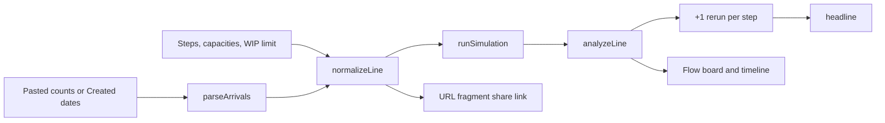

Queueglass replays a column of real arrivals through 2 to 8 workflow steps, each with the throughput you measured for it, and says which step limits flow and how fast the backlog clears. It is for a team lead looking at PR review, support triage, CI or procurement who has a tracker export and wants a number instead of a hunch.

<div className="fm-evidence-strip">
  <div className="fm-evidence-cell">
    <span className="fm-proof-label">Status</span>
    <span className="fm-proof-value">Shipped · live on Vercel</span>
  </div>
  <div className="fm-evidence-cell">
    <span className="fm-proof-label">Runtime</span>
    <span className="fm-proof-value">Next.js 16 static page · Node.js 24 to build</span>
  </div>
  <div className="fm-evidence-cell">
    <span className="fm-proof-label">Try it</span>
    <span className="fm-proof-value"><a href="https://queueglass.vercel.app">queueglass.vercel.app</a></span>
  </div>
  <div className="fm-evidence-cell">
    <span className="fm-proof-label">Proof hooks</span>
    <span className="fm-proof-value">19 unit tests, Chromium browser smoke, committed BPI 2019 derivation</span>
  </div>
</div>

## How it works



You enter the steps and paste arrivals. [`parseArrivals`](https://github.com/fortunexbt/queueglass/blob/main/src/lib/line.js) accepts one count per line, dated counts such as `2026-03-02,14`, or the Created column of a Jira, Linear or GitHub CSV export. A column of dates is tallied per day or per Monday-start week, with empty periods filled in. `normalizeLine` clamps the input to what the engine accepts: 2 to 8 steps, capacities from 1 to 99,999 and at most 1,000 periods of arrivals.

[`runSimulation`](https://github.com/fortunexbt/queueglass/blob/main/src/lib/simulation.js) is a deterministic tandem queue with no random input. Each period's arrivals join the first step. Steps are served from the last back to the first, oldest work first, each up to its capacity, so an item moves at most one step per period. With a WIP limit, a step stops passing work on while the next step already holds that many items. After the last arrival the run continues with no new work until the line is empty.

The backlog in a period is work that was ready to move and couldn't. That period's bottleneck is the unblocked step that left the most of it. Blocked steps are skipped because a full buffer downstream caused their leftover. `analyzeLine` calls the step that was the bottleneck most often the step that limits flow, finds the backlog peak and the first period after it with no backlog, and reruns the whole line once per step with that step's capacity raised by one. `headline` writes the verdict from those numbers and the reruns rather than from a queueing formula.

The line lives in the URL after the `#` (`encodeSetup` and `decodeSetup`), and browsers don't send that part to a server. The browser smoke checks that no request carries the line.

| File | Role |
| --- | --- |
| [`src/lib/simulation.js`](https://github.com/fortunexbt/queueglass/blob/main/src/lib/simulation.js) | Engine, bottleneck rule, analysis with +1 reruns |
| [`src/lib/line.js`](https://github.com/fortunexbt/queueglass/blob/main/src/lib/line.js) | Arrivals parsing, period labels, share-link fragment, worked example, headline |
| [`src/components/SimulatorLab.tsx`](https://github.com/fortunexbt/queueglass/blob/main/src/components/SimulatorLab.tsx) | Page state, verdict, +1 table, playback |
| [`src/components/FlowBoard.tsx`](https://github.com/fortunexbt/queueglass/blob/main/src/components/FlowBoard.tsx) | The steps at the selected period |
| [`src/components/Timeline.tsx`](https://github.com/fortunexbt/queueglass/blob/main/src/components/Timeline.tsx) | Per-step queue lanes, scrubber, table view |
| [`scripts/derive-bpi2019.mjs`](https://github.com/fortunexbt/queueglass/blob/main/scripts/derive-bpi2019.mjs) | Builds the example CSV from the BPI Challenge 2019 log |
| [`tests/simulation.test.js`](https://github.com/fortunexbt/queueglass/blob/main/tests/simulation.test.js), [`tests/line.test.js`](https://github.com/fortunexbt/queueglass/blob/main/tests/line.test.js) | Replay, conservation, blocking, parsing and headline tests |

## The worked example

The page opens on purchase-order lines from the BPI Challenge 2019 event log (B. F. van Dongen, 4TU.ResearchData, [doi:10.4121/uuid:d06aff4b-79f0-45e6-8ec8-e19730c248f1](https://doi.org/10.4121/uuid:d06aff4b-79f0-45e6-8ec8-e19730c248f1), CC BY 4.0). [`derive-bpi2019.mjs`](https://github.com/fortunexbt/queueglass/blob/main/scripts/derive-bpi2019.mjs) checks the 728 MB XES file against the MD5 that 4TU publishes. It then counts, for each day of 2018, the CAPEX & SOCS lines that were created and that first reached goods receipt, invoice receipt and invoice clearing. The output is committed as [`data/bpi2019-capex-socs-daily.2026-10-23.csv`](https://github.com/fortunexbt/queueglass/blob/main/data/bpi2019-capex-socs-daily.2026-10-23.csv), 365 rows.

Arrivals are the lines created per day. Each step's capacity is the 90th percentile of its daily count on the days it ran (`busyDay` in `line.js`): 46 goods receipts, 49 invoice receipts and 142 invoice clearings. At commit [`699dec0`](https://github.com/fortunexbt/queueglass/tree/699dec04d824dbc8a2f2ae78e3369db239d65e62) the replay prints:

> Goods receipt limits flow. It held work back on 20 of 367 days replayed. The backlog peaks at 78 items on 31 Oct 2018 and clears by 3 Nov 2018, 3 days later. With 47 a day at Goods receipt instead of 46, it would not clear any sooner; waiting would drop from 389 item-days to 363 item-days.

So one more unit of capacity at the bottleneck leaves the clear date unchanged and cuts total waiting by 26 item-days, about 7%. The waiting figure counts every item held back at any step in any period. A test in [`tests/line.test.js`](https://github.com/fortunexbt/queueglass/blob/main/tests/line.test.js) loads the committed CSV and checks the measured capacities.

The example has its own limits. The engine sends each line through all three steps, but 23% of CAPEX & SOCS lines skip at least one step in the real log, so the replay overstates the load on later steps. Capacity is fixed per day, weekends included. The numbers describe one spend area of one company's 2018 purchasing.

## Verify it

```bash
git clone https://github.com/fortunexbt/queueglass.git
cd queueglass
npm ci
npm run verify
```

`npm run verify` runs the secret scan, ESLint, the type check, the unit tests and `next build`. On 23 October 2026 it passed, with `tests 19`, `pass 19`, `fail 0`.

For the browser smoke, build and serve the app, then run the smoke from a second terminal:

```bash
npm run start -- -p 4173
npm run test:browser
```

It printed `Browser smoke passed: example verdict, playback, scrubbing, your own line, WIP and weeks, share links, 404, phone and reduced motion.` It needs Playwright's Chromium (`npx playwright install chromium`).

To reproduce the example headline without a browser:

```bash
node --input-type=module -e '
import { readFileSync } from "node:fs";
import { exampleSetup, headline } from "./src/lib/line.js";
import { analyzeLine } from "./src/lib/simulation.js";
const s = exampleSetup(readFileSync("data/bpi2019-capex-socs-daily.2026-10-23.csv", "utf8"));
const h = headline(s, analyzeLine(s.line));
console.log(h.title, h.detail.join(" "));'
```

Rebuilding the CSV itself needs the 728 MB `BPI_Challenge_2019.xes` from the DOI, then `node scripts/derive-bpi2019.mjs path/to/BPI_Challenge_2019.xes`. That step was not rerun for this page.

## Limits

- Capacity is one fixed number per step per period. Real throughput varies, and weekends count as working periods.
- Items pass through the steps in a fixed order. Rework and skipped steps can't be modelled.
- Periods are whole days or weeks, and an item takes at least one period per step.
- At most 8 steps and 1,000 periods of arrivals.
- The +1 analysis changes one step at a time. It doesn't search for the cheapest combination of changes.
- Everything runs in the browser tab. There is no account, storage or tracker integration, so you paste data in by hand.
- The browser smoke runs in Chromium only.
- `package.json` still says version `1.0.0` and the only GitHub release is v1.0.0 from July 2026, while `CHANGELOG.md` lists 2.0.0 for the 23 October 2026 rework. The live site serves the rework.

## Source

- [Repository](https://github.com/fortunexbt/queueglass)
- [Live app](https://queueglass.vercel.app)
- [CI workflow](https://github.com/fortunexbt/queueglass/actions/workflows/ci.yml)
- [Changelog](https://github.com/fortunexbt/queueglass/blob/main/CHANGELOG.md)
- [Real-arrivals rework, PR #10](https://github.com/fortunexbt/queueglass/pull/10)
- [Browser smoke](https://github.com/fortunexbt/queueglass/blob/main/scripts/browser-smoke.mjs)
