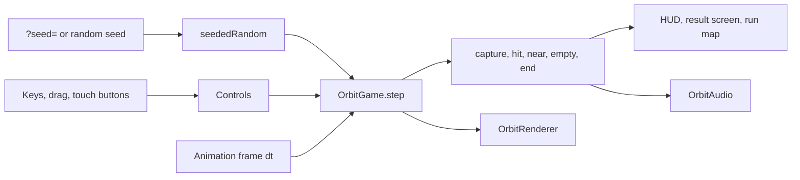

Solar Drift is a browser arcade game. Your ship always flies forward, and you steer it around a sun and back across your own wake. Every sun inside the closed loop is captured. It runs on Canvas 2D and synthesized Web Audio, with nothing to install and no network calls during play.

<div className="fm-evidence-strip">
  <div className="fm-evidence-cell">
    <span className="fm-proof-label">Status</span>
    <span className="fm-proof-value">Shipped · GitHub Pages</span>
  </div>
  <div className="fm-evidence-cell">
    <span className="fm-proof-label">Runtime</span>
    <span className="fm-proof-value">TypeScript · Canvas 2D · Web Audio · Vite build</span>
  </div>
  <div className="fm-evidence-cell">
    <span className="fm-proof-label">Try it</span>
    <span className="fm-proof-value">[fortunexbt.github.io/solar-drift](https://fortunexbt.github.io/solar-drift/)</span>
  </div>
  <div className="fm-evidence-cell">
    <span className="fm-proof-label">Proof hooks</span>
    <span className="fm-proof-value">15 Vitest rule tests, seeded runs, CI type-check and build</span>
  </div>
</div>

## How it works



[`src/orbit/main.ts`](https://github.com/fortunexbt/solar-drift/blob/main/src/orbit/main.ts) owns the lifecycle. On each animation frame it reads the keyboard, pointer and touch buttons into one `Controls` object and calls `OrbitGame.step` with the frame time, capped at 35 ms. The game waits for the first steering input before the ship or the clock moves.

All the rules live in [`src/orbit/physics.ts`](https://github.com/fortunexbt/solar-drift/blob/main/src/orbit/physics.ts). The ship turns at 3.15 rad/s. Its speed is 23% of the smaller viewport side, clamped to 92 to 160 px/s. The wake is a list of points that expire after 7 seconds. A loop closes when the ship passes within 8 px of a wake segment at least 18 points old and the enclosed polygon is at least 600 px². `pointInPolygon` then counts the suns inside it.

A capture scores `100 × suns² × chain`, so two suns in one loop pay four times one sun. The chain grows when you capture again within 9 seconds and stops at `MAX_CHAIN = 4`. Each captured sun adds 3 seconds, up to 90 seconds on the clock. Hitting a red body or the edge costs 5 seconds, clears the wake, resets the chain and gives 1.4 seconds of invulnerability. A near miss recharges surge.

Difficulty comes from the red bodies. Their target count is `min(16, 1 + floor(captured / 3))`. Their speed is `speed × (0.22 + 0.5 × c / (c + 30))` for `c` captured suns, and it applies to bodies already on the field.

Every run has an integer seed. `main.ts` takes a valid `?seed=` from the link for the first run after page load, or draws one with `Math.random`, and passes `seededRandom(seed)` (Park-Miller) to `OrbitGame`. The result screen shows the seed, and **Share this run** adds it to the link. The title-screen demo is the same `OrbitGame`, steered by `createAutopilot()` with fixed seeds 7, 8 and 10.

| File | Role |
| --- | --- |
| [`src/orbit/physics.ts`](https://github.com/fortunexbt/solar-drift/blob/main/src/orbit/physics.ts) | Movement, wake closure, capture, scoring, hazards, seeded RNG, autopilot |
| [`src/orbit/main.ts`](https://github.com/fortunexbt/solar-drift/blob/main/src/orbit/main.ts) | Frame loop, input, seed handling, result screen, share, local best score |
| [`src/orbit/render.ts`](https://github.com/fortunexbt/solar-drift/blob/main/src/orbit/render.ts) | Canvas drawing, capture sparks, hit shake |
| [`src/orbit/audio.ts`](https://github.com/fortunexbt/solar-drift/blob/main/src/orbit/audio.ts) | Synthesized motion bed and capture notes |
| [`src/orbit/physics.test.ts`](https://github.com/fortunexbt/solar-drift/blob/main/src/orbit/physics.test.ts) | Geometry, rules, difficulty, chain cap and seed tests |
| [`.github/workflows/pages.yml`](https://github.com/fortunexbt/solar-drift/blob/main/.github/workflows/pages.yml) | Runs `npm run check`, then deploys `dist/` to GitHub Pages |

## Verify it

```bash
git clone https://github.com/fortunexbt/solar-drift.git
cd solar-drift
npm ci
npm run check
```

`npm run check` runs `tsc --noEmit`, the Vitest suite and `vite build`. It needs Node.js 20.19 or newer. On 23 October 2026, at commit [`0c851c4`](https://github.com/fortunexbt/solar-drift/tree/0c851c41ae71e67e0c55a84fcedc9f589dc4649d), it printed `Tests 15 passed (15)` and built `dist/assets/index-Df1BA88P.js`. That is the same bundle name the GitHub Pages site serves.

The suite includes a check that two autopilot flights with seed 12345 end in the same state and a flight with seed 54321 doesn't. It also checks that hazard speed and count still rise past 15 and 34 captures, and that the result screen's best chain equals the capped value that scoring uses.

`npm run dev` serves the game locally through Vite.

## Limits

- A run has no fixed length. The clock starts at 60 seconds and each captured sun adds 3, so a player who keeps capturing can fly indefinitely. The page copy no longer calls them "60-second runs" ([PR #8](https://github.com/fortunexbt/solar-drift/pull/8)).
- Difficulty still levels off. Red bodies stop increasing at 16, after 45 captured suns. Their speed keeps rising but approaches 0.72 of the ship's base speed and never passes it.
- The README's rules table says red bodies go "up to six". The code allows 16. The cap of 6 was the value before PR #8.
- A seed fixes the opening sky and the random sequence. Live play steps with the real frame time, and later sun spawns depend on when and where you capture, so two players on one seed see the same start and then diverge. Spawn ranges also scale with the window size. The README's claim that a shared link "replays the same sky" holds for the opening layout only.
- There is no input recording or replay, and no browser or end-to-end test. The tests run the simulation in Node.
- The best score and the sound preference live in `localStorage` on one browser. There is no online leaderboard, so a shared score can't be verified.
- The Vercel deployment at [solar-drift-zeta.vercel.app](https://solar-drift-zeta.vercel.app/) is behind `main`. On 23 October 2026 it still served the "60-second runs" description and the old hazard cap of 6. The README and the `og:url` tag both point to it as the live demo. The GitHub Pages site matches `main`.
- The only GitHub release is v1.0.0 from July 2026, the Snake-based roguelite that the orbital game replaced in [PR #3](https://github.com/fortunexbt/solar-drift/pull/3). `package.json` still says `1.0.0`, and the changelog lists the October work under Unreleased.

## Source

- [Repository](https://github.com/fortunexbt/solar-drift)
- [Live game on GitHub Pages](https://fortunexbt.github.io/solar-drift/)
- [CI workflow](https://github.com/fortunexbt/solar-drift/actions/workflows/ci.yml)
- [Pages workflow](https://github.com/fortunexbt/solar-drift/actions/workflows/pages.yml)
- [Changelog](https://github.com/fortunexbt/solar-drift/blob/main/CHANGELOG.md)
- [Run-length, difficulty, chain and seed fixes, PR #8](https://github.com/fortunexbt/solar-drift/pull/8)
