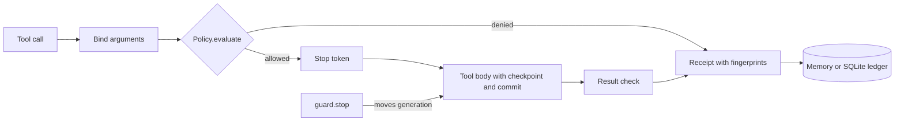

Switchyard has two parts. [`guard/`](https://github.com/fortunexbt/switchyard/tree/main/guard) is a Python package whose `@guard.gated(capability, risk)` decorator checks every call to a tool function against a deny-by-default policy, lets you stop calls that are already running, and records a receipt with SHA-256 fingerprints of the arguments and result instead of the values. The console is a browser demo of the same pattern that replays one invented incident drill so you can press Stop mid-run and read the receipt. It is for Python developers who hand functions to an agent as tools.

<div className="fm-evidence-strip">
  <div className="fm-evidence-cell">
    <span className="fm-proof-label">Status</span>
    <span className="fm-proof-value">Verified, package installs from source, console demo on Vercel</span>
  </div>
  <div className="fm-evidence-cell">
    <span className="fm-proof-label">Runtime</span>
    <span className="fm-proof-value">Python 3.11+ standard library, TypeScript port, FastAPI and SQLite for the local console</span>
  </div>
  <div className="fm-evidence-cell">
    <span className="fm-proof-label">Try it</span>
    <span className="fm-proof-value"><a href="https://switchyard-phi.vercel.app">switchyard-phi.vercel.app</a></span>
  </div>
  <div className="fm-evidence-cell">
    <span className="fm-proof-label">Proof hooks</span>
    <span className="fm-proof-value">5 guarantees with Hypothesis and fast-check property tests, shared golden hashes, 102 tests in CI</span>
  </div>
</div>

## How it works



`Guard.gated` in [`guard.py`](https://github.com/fortunexbt/switchyard/blob/main/guard/src/switchyard_guard/guard.py) binds the call's arguments to the function signature, defaults included, and passes them to `Policy.evaluate` in [`policy.py`](https://github.com/fortunexbt/switchyard/blob/main/guard/src/switchyard_guard/policy.py). A call passes when the stop is open, its capability is granted, its declared risk is at or below the grant (`read < write < destructive`), its budget has calls left and every `Rule` that applies returns `True`. A rule that raises counts as a failure. The decision and the budget count happen under one lock, so concurrent calls can't overspend. A refused call raises `Denied` or `BudgetExhausted` before the function body runs.

An admitted call takes a token, the stop generation at admission. [`StopController`](https://github.com/fortunexbt/switchyard/blob/main/guard/src/switchyard_guard/stop.py) moves the generation on at the first `latch` and at every `reset`, so a call admitted before a stop can't complete even if someone resets while it runs. Sync tools end at their next `checkpoint()`. Async tools are also cancelled at their current await, and only the cancel that `stop()` sends becomes `Stopped`. A timeout or task-group cancel stays a `CancelledError`. `Stopped` subclasses `BaseException`, so a broad `except Exception` in an agent loop doesn't swallow it. A side effect wrapped in `commit()` runs only under a valid token, and a stop pressed meanwhile waits for it to finish. A tool that returns after the stop has its result withheld with code `stopped.after-return`.

Every outcome writes a receipt with the tool, capability, risk, status, code, generation, argument and result fingerprints and duration. [`fingerprint.py`](https://github.com/fortunexbt/switchyard/blob/main/guard/src/switchyard_guard/fingerprint.py) hashes canonical JSON with sorted keys and JavaScript number formatting, and switches to HMAC-SHA256 when you pass `fingerprint_key`. If a receipt can't be written, the guard latches the stop and re-raises.

The console's backend uses the same `StopController`. [`ActionGateway`](https://github.com/fortunexbt/switchyard/blob/main/backend/app/execution.py) is the only route into execution. `PolicyEngine` allows only `fixture.replay`, `stop.enable` and `stop.reset`. `SyntheticExecutor` holds a 4 s inspection window, checking its token every 100 ms, before it loads [`orbital-relay-recovery.json`](https://github.com/fortunexbt/switchyard/blob/main/backend/app/demo_data/orbital-relay-recovery.json). The pause exists only so you can stop the run, and the fixture itself calls the drill invented. A stopped replay returns HTTP 423 with code `denied.stop-during-execution` and no result. The hosted demo is built with `VITE_DEMO_MODE=true` and runs [`engine.ts`](https://github.com/fortunexbt/switchyard/blob/main/frontend/src/lib/engine.ts), a TypeScript port of the gateway, entirely in the browser.

| File | Role |
| --- | --- |
| [`guard/src/switchyard_guard/guard.py`](https://github.com/fortunexbt/switchyard/blob/main/guard/src/switchyard_guard/guard.py) | Decorator, admission, async cancellation, receipts |
| [`guard/src/switchyard_guard/policy.py`](https://github.com/fortunexbt/switchyard/blob/main/guard/src/switchyard_guard/policy.py) | Grants, risk order, budgets, rules, pure `evaluate` |
| [`guard/src/switchyard_guard/stop.py`](https://github.com/fortunexbt/switchyard/blob/main/guard/src/switchyard_guard/stop.py) | Generation tokens, `latch`, `reset`, `checkpoint`, `commit` |
| [`guard/src/switchyard_guard/ledger.py`](https://github.com/fortunexbt/switchyard/blob/main/guard/src/switchyard_guard/ledger.py) | `MemoryLedger` and `SQLiteLedger` |
| [`guard/goldens.json`](https://github.com/fortunexbt/switchyard/blob/main/guard/goldens.json) | Canonical JSON, hashes and decisions both languages must match |
| [`guard/tests/test_properties.py`](https://github.com/fortunexbt/switchyard/blob/main/guard/tests/test_properties.py) | Hypothesis tests for the five guarantees |
| [`frontend/src/lib/guard.ts`](https://github.com/fortunexbt/switchyard/blob/main/frontend/src/lib/guard.ts) | TypeScript port of the package |
| [`backend/app/execution.py`](https://github.com/fortunexbt/switchyard/blob/main/backend/app/execution.py) | Console gateway, planner, paced fixture executor |
| [`backend/app/storage.py`](https://github.com/fortunexbt/switchyard/blob/main/backend/app/storage.py) | Metadata-only `audit_receipts` table |

## The five guarantees

The [package README](https://github.com/fortunexbt/switchyard/blob/main/guard/README.md#guarantees) states five guarantees and names a Python and a TypeScript test for each.

1. No side effect commits after the stop latches.
2. A call admitted before any stop or reset never commits again and never returns a result.
3. Pressing stop many times, from any number of threads, equals pressing it once.
4. A stopped call halts at its first checkpoint after the latch, or at its current await if it is async.
5. Once a capability's budget is spent, no call to it executes.

Hypothesis picks thread counts, timings and stop and reset sequences for the Python tests. fast-check picks interleavings of concurrent async calls for the TypeScript tests. The README says each test was checked by breaking the matching code on purpose, and that the property tests found one real bug, a stop landing between an async call's admission and its registration for cancellation. That fix is the re-check after `_track` in `guard.py`. The mutation runs aren't recorded in the repository and were not repeated for this page.

## Verify it

These ran on 18 November 2026 against `main` at `34e9dbc` with Python 3.12 and Node.js 24.18. The pinned `pytest` versions in `backend/requirements-dev.txt` (9.2.0) and the `guard[test]` extra (9.1.1) conflict, so the single-venv install in the README fails. CI installs them in separate jobs, and so did this run:

```bash
gh repo clone fortunexbt/switchyard && cd switchyard
python3.12 -m venv .venv-g && .venv-g/bin/pip install -e "guard[test]"
.venv-g/bin/python -m pytest -c guard/pyproject.toml guard/tests -q
python3.12 -m venv .venv-b && .venv-b/bin/pip install -r backend/requirements-dev.txt -e guard
PYTHONPATH=backend .venv-b/bin/python -m pytest -c backend/pytest.ini backend/tests -q
cd frontend && npm ci --ignore-scripts && npm test && npm run typecheck && npm run build
```

The guard suite printed `54 passed in 12.68s`. The backend suite printed `20 passed in 0.45s`. `npm test` printed `tests 28`, `pass 28`, `fail 0`, and the typecheck and build passed. `bash scripts/scan-secrets.sh` printed `No high-signal credential patterns found.` The `pip_audit` and `npm audit` steps from `scripts/check.sh` were not run for this page. The [`verify` workflow](https://github.com/fortunexbt/switchyard/actions/workflows/ci.yml) passed on `34e9dbc` on 6 November 2026.

To see the gate and stop on real functions:

```bash
.venv-g/bin/python guard/examples/workspace_tools.py
.venv-g/bin/python guard/examples/stop_long_job.py
```

The first wrote and read a file in a temporary workspace, then printed `read_file({'path': '../../../etc/passwd'}) -> denied: denied.rule.path.inside-workspace` and `delete_file({'path': 'notes/plan.md'}) -> denied: denied.capability`. The second hashed the Python standard library and printed `stopped after 769 files, 208 ms in`, a receipt with code `stopped.in-flight` and no result fingerprint, and `next call while latched: denied.stop-active, 0 files hashed`. The file count and time vary per run. `guard/examples/http_fetch.py` needs network access and was not run.

## Limits

- `switchyard-guard` 0.1.0 isn't on PyPI. You install it from a clone with `pip install ./guard`.
- The gate sees the arguments a tool is called with, not what the tool does with them. A rule over `path` doesn't stop a tool that opens a different path inside.
- A sync tool with no `checkpoint()` calls runs to the end. The stop then withholds its result and blocks later calls.
- Stop state and budgets live in one process. Two processes sharing a tool need a shared controller, which the package doesn't provide.
- Receipts aren't signed. Whoever can write the SQLite file can rewrite them, and an unkeyed fingerprint of a short value can be guessed.
- The console replays one invented drill and has no live integrations. The local API has no authentication and binds to `127.0.0.1` by default.
- The hosted demo keeps receipts in the browser tab, and they clear on reload.
- The only GitHub release, v1.0.0 from July 2026, predates the `guard/` package and the TypeScript port, which landed in October 2026.
- The README's one-venv install command fails at `34e9dbc` because two `pytest` pins conflict.

## Source

- [Repository](https://github.com/fortunexbt/switchyard)
- [Live demo](https://switchyard-phi.vercel.app)
- [Package README](https://github.com/fortunexbt/switchyard/blob/main/guard/README.md)
- [Architecture notes](https://github.com/fortunexbt/switchyard/blob/main/ARCH.md)
- [Security model](https://github.com/fortunexbt/switchyard/blob/main/SECURITY.md)
- [CI workflow](https://github.com/fortunexbt/switchyard/actions/workflows/ci.yml)
- [Stop core and budgets, PR #29](https://github.com/fortunexbt/switchyard/pull/29)

Reviewed 18 November 2026 against [`34e9dbc`](https://github.com/fortunexbt/switchyard/tree/34e9dbc84c5c039b65b1bd76dc3ac43c1b770f23).
