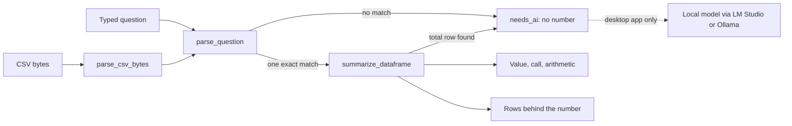

Tablebeam answers questions such as `Average body mass g by species` about a CSV. It accepts only a short list of question forms, runs the calculation in pandas over every row and shows what the question parsed to, the function call, the written-out arithmetic and the rows used. A browser demo runs the same Python in WebAssembly, and a Streamlit app adds filters, Google Sheets import and an optional local model for questions the parser refuses.

<div className="fm-evidence-strip">
  <div className="fm-evidence-cell">
    <span className="fm-proof-label">Status</span>
    <span className="fm-proof-value">Shipped · browser demo and Streamlit app</span>
  </div>
  <div className="fm-evidence-cell">
    <span className="fm-proof-label">Runtime</span>
    <span className="fm-proof-value">Python 3.10–3.12 and pandas · Pyodide 314.0.7 in the browser</span>
  </div>
  <div className="fm-evidence-cell">
    <span className="fm-proof-label">Try it</span>
    <span className="fm-proof-value">[tablebeam-eight.vercel.app](https://tablebeam-eight.vercel.app) · no model, nothing uploaded</span>
  </div>
  <div className="fm-evidence-cell">
    <span className="fm-proof-label">Proof hooks</span>
    <span className="fm-proof-value">Pinned evaluation against pandas, SQLite and DuckDB · 397 tests</span>
  </div>
</div>

## How it works



`parse_csv_bytes` checks the raw file before pandas sees it. It needs UTF-8, unique non-empty headers, the same number of fields in every record, at most 100 MB and at most 250,000 rows. A file that fails any check is refused with a message, and the current table stays loaded.

`parse_question` accepts `Count rows`, `How many rows are there?` and `Total`, `Sum`, `Average`, `Median`, `Minimum` or `Maximum` followed by a column name, each with an optional `by <column>`. One `What is the`, `Show me` or `Calculate` wrapper is allowed. Underscores and dashes in headers can be typed as spaces. The function returns a `Calculation` only when exactly one reading matches real columns and the measure column has a numeric dtype. Partial column names, filters in the question and any other wording return `None`, and the caller shows no number.

`summarize_dataframe` runs the calculation over the whole table. Integer sums are cast to Python `int`, so they keep every digit past 2^53 and can't overflow. Averages and medians are pandas float64. Before it returns a single number other than a minimum, it looks for a row that totals the others: a text cell reading `Total`, `Totals` or `Grand total`, or a measure that equals the sum of the remaining rows when at least three of them are non-zero. If it finds one it raises an error instead of counting that row twice. Grouped answers show such a row as its own group.

`answer_format.py` rounds the displayed value to six significant digits through `Decimal`, half up, after dropping float noise at 15 digits. The result table and downloads keep full precision. In the browser, `web/engine.py` adds the evidence: up to 25 rows behind the number (or behind one group), and the arithmetic written out when 12 or fewer values contribute. For the six astrometry planets in `Average mass earths by discovery method` it prints `(9057.77 + 718.29219982 + 1589.142035 + 3750.3752026 + 6633.07885409 + 6293.0024586) / 6 = 4673.610125018334`.

`web/build.sh` copies four modules from `src/` into the static site byte for byte, and `web/worker.js` loads them into Pyodide off the main thread. `tests/test_web_demo.py` fails if the copies drift from `src/`. The demo ships two real datasets: all 6,451 confirmed planets from the NASA Exoplanet Archive `pscomppars` table, retrieved 22 October 2026, and the 344-row Palmer penguins table (CC0 1.0).

The Streamlit app in `src/app.py` uses the same parser and calculation, adds a calculation builder with typed filters, the five previous answers and CSV downloads that neutralise formula-like text. When the parser refuses a question, the user can choose **Ask AI**. `src/assistant_core.py` then picks up to eight rows with a lexical ranker and sends them, the table profile and the question to an OpenAI-compatible endpoint. That path doesn't exist in the browser demo.

| File | What it does |
|---|---|
| [`src/data_pipeline.py`](https://github.com/fortunexbt/tablebeam/blob/main/src/data_pipeline.py) | Validates raw CSV bytes, loads them into pandas, builds the table profile |
| [`src/question_actions.py`](https://github.com/fortunexbt/tablebeam/blob/main/src/question_actions.py) | `parse_question` and the suggested questions built from column names |
| [`src/table_analysis.py`](https://github.com/fortunexbt/tablebeam/blob/main/src/table_analysis.py) | `summarize_dataframe`, the total-row check, filters, formula-safe CSV export |
| [`src/answer_format.py`](https://github.com/fortunexbt/tablebeam/blob/main/src/answer_format.py) | Display rounding and the plain-language calculation details |
| [`web/engine.py`](https://github.com/fortunexbt/tablebeam/blob/main/web/engine.py) | Browser entry point: load, ask, evidence rows and written-out arithmetic |
| [`web/worker.js`](https://github.com/fortunexbt/tablebeam/blob/main/web/worker.js) | Starts Pyodide in a module worker and loads the copied modules |
| [`web/build.sh`](https://github.com/fortunexbt/tablebeam/blob/main/web/build.sh) | Builds `web/dist` for Vercel by copying `src/` modules unchanged |
| [`src/app.py`](https://github.com/fortunexbt/tablebeam/blob/main/src/app.py) | Streamlit app, calculation builder, optional **Ask AI** |
| [`src/assistant_core.py`](https://github.com/fortunexbt/tablebeam/blob/main/src/assistant_core.py) | Lexical row retrieval and the OpenAI-compatible model call |

## Evaluation against pandas, SQLite and DuckDB

[`eval/run_eval.py`](https://github.com/fortunexbt/tablebeam/tree/f141ee739f028bb74e98023eccd94ed261251377/eval) measures the parser and calculations, with no model in the loop. It reads inputs pinned by SHA-256 in `eval/inputs/manifest.json` and writes [`results.md`](https://github.com/fortunexbt/tablebeam/blob/f141ee739f028bb74e98023eccd94ed261251377/eval/results.md) and `results.json`. With the versions in `eval/requirements.txt` (Python 3.12, pandas 3.1.0, numpy 2.5.4, DuckDB 2.0.0, SQLite 3.54.1) a rerun produces byte-identical files.

There are two spec sets, each a (operation, measure, group) triple run through four executors with their default CSV readers. Tablebeam is asked the documented question form through `web/engine.py`. pandas uses `read_csv`. SQLite imports every field as TEXT, as the `sqlite3` shell's `.import` does. DuckDB uses `read_csv` auto-detection.

- 554 WikiTableQuestions (WTQ) specs (CC BY-SA 4.0): whole-table counts, totals, averages, minimums and maximums about tables copied from Wikipedia, picked out by SQUALL's hand-written SQL (CC BY-SA 4.0). Ground truth comes from SQUALL's SQL run in DuckDB, kept only where pandas agrees and the human WikiTableQuestions answer matches. That dropped 16 questions.
- 162 specs over four CSVs with hard number formats: the U.S. Treasury's Debt to the Penny (public domain), 9th European Parliament members with X user IDs from Wikidata (CC0), and the 2022 Paris and 2023 Montpellier rent-control tables (Licence Ouverte 2.0). The reference parses each cell as written and aggregates with exact fractions, cross-checked against DuckDB `DECIMAL`.

"Silent wrong" means a number came back wrong with no error. Rates are from `results.md` at `f141ee7`. Rerunning the evaluation on 23 October 2026 reproduced both result files byte for byte.

| Executor | WTQ silent wrong | WTQ refused | Hard-format silent wrong | Hard-format refused |
|---|---|---|---|---|
| Tablebeam | 0.4% (2 of 554) | 20.6% | 0.0% (0 of 162) | 37.0% |
| pandas | 13.7% | 1.3% | 19.8% | 18.5% |
| SQLite | 17.2% | 2.4% | 38.9% | 22.2% |
| DuckDB | 11.7% | 3.8% | 33.3% | 11.7% |

Refusal does most of the work. Of the 76 WikiTableQuestions specs where pandas is silently wrong, Tablebeam refuses 74 and gets the other 2 wrong too. It never returns the right number where pandas returns a wrong one. Against DuckDB the split is 61 refused and 2 answered correctly, and against SQLite 75 refused and 18 correct. Overall Tablebeam answers 79.1% of the specs correctly against 85.0% for pandas and 84.5% for DuckDB. Its 114 refusals are 54 columns stored as text (`12,467`, `41 (2)`), 33 total rows, 14 blank headers and 13 duplicate headers. On the hard-format set it refuses 60 of Montpellier's 65 specs because it doesn't read `"18,1"` as a number. A refused spec gets no number at all.

Total rows explain a large share of the gap. Of the silent wrong answers from pandas (76), SQLite (95) and DuckDB (65), 32 each are on the same specs: ones where Tablebeam refuses because the table has its own total row, and all three other executors return a wrong number. Counting every table with a cell that reads Total, Career or All, it's 43, 47 and 37, roughly half of each executor's gap to Tablebeam. Both counts were computed for this page from `results.json` and the pinned tables, and the repo doesn't publish them. Tablebeam's own two wrong answers are row counts on tables with a summary row its check misses: one labelled `TOTAL (1–12)` and one with region separator rows.

Limits of the evaluation, mostly from the repo's own README:

- Every executor runs with defaults. An analyst who sets column types or a decimal separator in pandas or DuckDB would get other numbers.
- Two thirds of the 554 WikiTableQuestions specs are row counts, and only 16 are averages.
- None of the 954 questions parsed in the wording people wrote them in, such as "how many total gold medals were won?". The 554 specs are re-asked in Tablebeam's documented form.
- The WikiTableQuestions CSVs were re-quoted to standard CSV, because Tablebeam and Python's `csv` module reject the originals' backslash-escaped quotes.
- "Correct" accepts float noise in averages and medians, to one part in 10^12. Counts, totals, minimums and maximums must match to the last decimal.
- The total-row check is a heuristic. It was added during this evaluation, and on this data it also refused one count that the ground truth expected to include the total row.
- The Wikidata and Treasury files are snapshots from 23 October 2026.

## Verify it

Run the test suite in a clone:

```bash
git clone https://github.com/fortunexbt/tablebeam.git
cd tablebeam
python3.12 -m venv .venv && . .venv/bin/activate
python -m pip install -r requirements-dev.txt
pytest -q
```

On 23 October 2026 at `f141ee7` this printed `397 passed, 2 warnings` in about 33 seconds. The tests use fake provider responses and need no model.

Ask the browser engine one question from the command line, using the bundled penguins table:

```bash
python -c "
import sys; sys.path[:0] = ['src', 'web']
import engine
engine.load(open('web/datasets/penguins.csv', 'rb').read(), 'Palmer penguins')
a = engine.ask('Average body mass g by species')
print(a['call'])
for r in a['result']: print(r['group'], r['value'], r['rows'])
print(engine.ask('which penguins are heavier than 5000 g?')['kind'])
"
```

This printed `summarize_dataframe(table, 'mean', 'body_mass_g', 'species')`, then `Gentoo 5,076.02 124`, `Chinstrap 3,733.09 68`, `Adelie 3,700.66 152`, then `needs_ai` for the question outside the supported forms.

To rerun the evaluation, follow [the recipe](/recipes/tablebeam-exact-answers).

## Limits

- The live demo serves the engine from `0b97d13`, the commit before the evaluation. On 23 October 2026 its `table_analysis.py`, `answer_format.py` and `engine.py` differ from `main`, so the total-row refusal and the two display fixes from the evaluation aren't live yet.
- Only the listed question forms get a number. There are no filters, joins, rankings or lookups in typed questions. The Streamlit calculation builder adds AND filters.
- Averages and medians are float64. Only integer sums are exact past 2^53.
- Text columns holding numbers (`12,467`, `"18,1"`, `£6,600`) are refused rather than parsed.
- The Streamlit `--demo` table is still `sample_data.csv`, 12 invented customer accounts. The real datasets are only in the browser demo under `web/datasets/`.
- **Ask AI** in the Streamlit app sends up to eight rows, the profile and the question to whichever endpoint is configured. Its answers aren't checked by the engine. Loading a public Google Sheet fetches it from Google.
- The browser demo downloads about 19 MB of Pyodide and pandas from jsDelivr on first load.
- The latest release, `v2.0.0` from July 2026, and its `ghcr.io/fortunexbt/tablebeam:2.0.0` image predate the parser, the browser demo and the evaluation.

## Source

- [Repository](https://github.com/fortunexbt/tablebeam)
- [Live demo](https://tablebeam-eight.vercel.app)
- [Evaluation at `f141ee7`](https://github.com/fortunexbt/tablebeam/tree/f141ee739f028bb74e98023eccd94ed261251377/eval)
- [Bundled datasets and credits](https://github.com/fortunexbt/tablebeam/blob/main/web/catalog.json)
- [Tests workflow](https://github.com/fortunexbt/tablebeam/actions/workflows/test.yml)
- [Releases](https://github.com/fortunexbt/tablebeam/releases)

<Card title="Rerun the evaluation" icon="calculator" href="/recipes/tablebeam-exact-answers" horizontal>
  Regenerate the published results from pinned inputs in about two minutes, offline, and count the total-row cases.
</Card>
