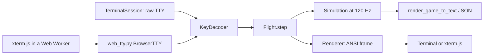

Terminal Starfield is a space-combat roguelite drawn with ANSI text, for people who want a game in the terminal or a seeded text renderer they can test. The same Python package runs in a local TTY and, on Pyodide, in the browser at [terminal-starfield.vercel.app](https://terminal-starfield.vercel.app).

<div className="fm-evidence-strip">
  <div className="fm-evidence-cell">
    <span className="fm-proof-label">Status</span>
    <span className="fm-proof-value">Shipped · v4.0.0 release and web build</span>
  </div>
  <div className="fm-evidence-cell">
    <span className="fm-proof-label">Runtime</span>
    <span className="fm-proof-value">Python 3.9+ with no runtime dependencies · Pyodide in the browser</span>
  </div>
  <div className="fm-evidence-cell">
    <span className="fm-proof-label">Try it</span>
    <span className="fm-proof-value">[terminal-starfield.vercel.app](https://terminal-starfield.vercel.app)</span>
  </div>
  <div className="fm-evidence-cell">
    <span className="fm-proof-label">Proof hooks</span>
    <span className="fm-proof-value">`--snapshot`, `--state-snapshot` JSON, 128 unittest cases</span>
  </div>
</div>

## How it works



`Flight` in [`cli.py`](https://github.com/fortunexbt/terminal-starfield/blob/main/terminal_starfield/cli.py) is one session's game loop. Each call to `Flight.step(events, dt, width, height)` applies decoded input, advances the simulation by `dt` and returns the next ANSI frame, or `None` when the player quits. It does no terminal I/O itself.

Two front ends feed it. In a terminal, `TerminalSession` puts stdin in cbreak mode, switches to the alternate screen, traps `SIGWINCH` and `SIGTERM`, and restores the TTY on normal exit, <kbd>Ctrl</kbd>+<kbd>C</kbd> and `SIGTERM`. `run_interactive` reads stdin bytes, hands them to `KeyDecoder`, and writes the frame at the `--fps` rate. In the browser, [`web/src/game.worker.js`](https://github.com/fortunexbt/terminal-starfield/blob/main/web/src/game.worker.js) loads Pyodide from jsDelivr, writes the unmodified `terminal_starfield/*.py` files (bundled by Vite at build time) into the Pyodide filesystem, and imports [`web/src/web_tty.py`](https://github.com/fortunexbt/terminal-starfield/blob/main/web/src/web_tty.py). That 31-line `BrowserTTY` class builds the same `Flight` from the same argument parser and steps it with bytes and a size from xterm.js. The page passes `--mouse` on laptops and `--auto-fire` on touch devices, per [`main.js`](https://github.com/fortunexbt/terminal-starfield/blob/main/web/src/main.js).

`Simulation` in [`model.py`](https://github.com/fortunexbt/terminal-starfield/blob/main/terminal_starfield/model.py) advances in fixed steps of `1/120` s regardless of frame rate, and keeps separate `random.Random` instances for combat and for cosmetic stars, so star density or theme changes do not consume combat randomness. A seed with the same ship, ruleset and inputs at the same simulation times reproduces a run. A seed is not a saved input replay.

The snapshot flags skip the interactive loop. `--snapshot WxH` and `--state-snapshot` build a `Simulation` (seed 42 if none is given), advance it 2.2 s, optionally stage a preview screen with `--snapshot-screen`, and print either one rendered frame or the state as sorted JSON. Neither reads nor writes the flight log.

| File | Role |
|---|---|
| [`starfield.py`](https://github.com/fortunexbt/terminal-starfield/blob/main/starfield.py) | Checkout launcher that calls `cli.main` |
| [`terminal_starfield/cli.py`](https://github.com/fortunexbt/terminal-starfield/blob/main/terminal_starfield/cli.py) | Argument parser, `KeyDecoder`, `TerminalSession`, `Flight`, snapshot modes |
| [`terminal_starfield/model.py`](https://github.com/fortunexbt/terminal-starfield/blob/main/terminal_starfield/model.py) | Ships, enemies, weapons, waves, routes, fixed-step update, state JSON |
| [`terminal_starfield/content.py`](https://github.com/fortunexbt/terminal-starfield/blob/main/terminal_starfield/content.py) | Boss profiles, routes, refit services, extra upgrades |
| [`terminal_starfield/render.py`](https://github.com/fortunexbt/terminal-starfield/blob/main/terminal_starfield/render.py) | Projection, HUD, overlays, ANSI and ASCII frames |
| [`terminal_starfield/graphics.py`](https://github.com/fortunexbt/terminal-starfield/blob/main/terminal_starfield/graphics.py) | Planets, rings and ship silhouettes drawn onto a duck-typed canvas |
| [`terminal_starfield/pilot.py`](https://github.com/fortunexbt/terminal-starfield/blob/main/terminal_starfield/pilot.py) | `--demo` pilot that uses the player's actions |
| [`terminal_starfield/records.py`](https://github.com/fortunexbt/terminal-starfield/blob/main/terminal_starfield/records.py) | Local flight log with locked, atomic writes |
| [`web/src/web_tty.py`](https://github.com/fortunexbt/terminal-starfield/blob/main/web/src/web_tty.py) | Browser stand-in for `TerminalSession` |
| [`web/src/game.worker.js`](https://github.com/fortunexbt/terminal-starfield/blob/main/web/src/game.worker.js) | Pyodide boot, IndexedDB flight log, tick loop |

The game has four modes. Campaign runs 15 waves across three sectors with three flagships. Endless keeps going after that. Zen Drift is the HUD-free starfield, and Voyage (start it with `--mode voyage`) is a signal-and-debris run. Three hulls (Vanguard, Wraith, Aegis) change starting shields and weapons.

## Verify it

Run these from a clone. All four were run on 23 October 2026 at commit [`3765e27`](https://github.com/fortunexbt/terminal-starfield/tree/3765e2747d006b8c2fde4e0c8590f7c885b49395) with Python 3.15 on macOS.

```bash
git clone https://github.com/fortunexbt/terminal-starfield.git
cd terminal-starfield
python3 -m unittest discover -s tests -v
python3 starfield.py --snapshot 80x24 --seed 42 --no-color --ascii
python3 starfield.py --state-snapshot --seed 42
```

The unittest run reported `Ran 128 tests` and `OK`. The snapshot printed an 80×24 ASCII frame, and the state snapshot printed one JSON object with keys including `enemies`, `player`, `route_history`, `run_stats`, `target` and `weapons`. The [test workflow](https://github.com/fortunexbt/terminal-starfield/blob/main/.github/workflows/test.yml) runs the same unittest command on Ubuntu and macOS with Python 3.9 and 3.13.

Use `unittest` (or `python3 -m pytest`). A bare `pytest` fails at collection with `ModuleNotFoundError: No module named 'terminal_starfield'`, because the repo has no pytest config that puts its root on `sys.path`.

To install the `starfield` command, install from Git:

```bash
pipx install git+https://github.com/fortunexbt/terminal-starfield.git
starfield --version   # terminal-starfield 4.0.0
```

The README's `pipx install terminal-starfield` fails today because the package isn't on PyPI (`https://pypi.org/pypi/terminal-starfield/json` returns 404). A [release workflow](https://github.com/fortunexbt/terminal-starfield/blob/main/.github/workflows/release.yml) that publishes to PyPI on the next published GitHub release was added after v4.0.0.

To run the browser build locally, `cd web && npm ci && npm run dev` serves it on port 4231. The web build wasn't run locally for this page. The live site returned HTTP 200 on 23 October 2026.

## Limits

- Interactive play needs a TTY on macOS or Linux, or Windows Terminal through WSL. Without a TTY the game exits with code 2 and suggests `--snapshot`.
- No runtime dependencies means no Python packages. Python and a terminal with box-drawing and Braille glyphs are still required; `--ascii` covers terminals without them.
- A seed fixes random draws, not timing. Live keyboard input at different simulation times produces a different run.
- Snapshot output shows layout and state for staged screens. It says nothing about frame rate.
- The browser build downloads the Pyodide runtime (about 6 MB per the README) from jsDelivr on first launch, exposes only `--mouse`, `--auto-fire` and `--demo`, and keeps the flight log in that browser's IndexedDB.
- Flight records are local to one machine or one browser. Nothing is uploaded.

## Source

- [Repository](https://github.com/fortunexbt/terminal-starfield)
- [Live browser build](https://terminal-starfield.vercel.app)
- [v4.0.0 release](https://github.com/fortunexbt/terminal-starfield/releases/tag/v4.0.0)
- [Test workflow runs](https://github.com/fortunexbt/terminal-starfield/actions/workflows/test.yml)
- [Changelog](https://github.com/fortunexbt/terminal-starfield/blob/main/CHANGELOG.md)
- [Tests](https://github.com/fortunexbt/terminal-starfield/tree/main/tests)

<Card title="Replay a seeded starfield" icon="binary" href="/recipes/starfield-seeded-run" horizontal>
  Render the same seeded frame twice, compare it byte for byte, and read the state snapshot.
</Card>
