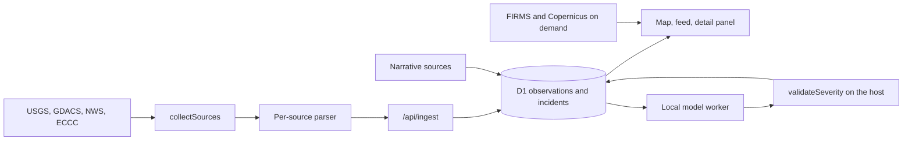

World Watch collects earthquakes from USGS, Orange and Red disaster alerts from GDACS, US storm-based warnings from the National Weather Service and Canadian weather warnings from Environment and Climate Change Canada, and plots them on one flat map. NASA FIRMS thermal detections and Copernicus emergency mapping areas are optional layers. It's for someone who wants a single view of current natural hazards with a link back to each issuer's record. `npm run demo` runs it locally against the live feeds.

<div className="fm-evidence-strip">
  <div className="fm-evidence-cell">
    <span className="fm-proof-label">Status</span>
    <span className="fm-proof-value">Experiment · local demo, hosted deployment paused</span>
  </div>
  <div className="fm-evidence-cell">
    <span className="fm-proof-label">Runtime</span>
    <span className="fm-proof-value">TypeScript · Cloudflare Worker and D1 via Wrangler · React and MapLibre</span>
  </div>
  <div className="fm-evidence-cell">
    <span className="fm-proof-label">Try it</span>
    <span className="fm-proof-value">`npm ci && npm run demo`, no API keys</span>
  </div>
  <div className="fm-evidence-cell">
    <span className="fm-proof-label">Proof hooks</span>
    <span className="fm-proof-value">315 offline tests, reproducible severity-gate evaluation</span>
  </div>
</div>

## How it works



[`scripts/demo.ts`](https://github.com/fortunexbt/world-watch/blob/main/scripts/demo.ts) creates a temporary directory with random owner, collector and worker tokens. It applies the D1 migrations to a throwaway local database and starts `wrangler dev` on port 8797. It then runs the collector for four registry entries: `global-usgs-earthquakes`, `global-gdacs-alerts`, `us-nws-warnings` and `ca-eccc-warnings`. A preview server opens on `http://127.0.0.1:4319/?hours=168`, the collector reruns every five minutes, and Ctrl-C deletes the temporary directory. The demo calls no model.

[`collectSources`](https://github.com/fortunexbt/world-watch/blob/main/src/collector/index.ts) fetches each source from its registry URL with a byte cap and hands the response to that source's parser. Each parser turns issuer records into observations that carry the canonical record URL, the issuer's fields as a JSON excerpt and an `official` block with activity and impact. The server's `ingest` in [`src/server/index.ts`](https://github.com/fortunexbt/world-watch/blob/main/src/server/index.ts) publishes an official record with a location as an incident straight away, with no model step. A changed record becomes a new revision of the same incident.

Impact comes from the issuer's own level, mapped one way per source, and never reaches `critical`:

| Issuer level | World Watch impact |
| --- | --- |
| USGS PAGER green, GDACS Green, ECCC Yellow, NWS CAP Moderate | minor |
| PAGER yellow, GDACS Orange, ECCC Orange, NWS Severe | significant |
| PAGER orange or red, GDACS Red, ECCC Red, NWS Extreme | severe |
| None issued | unknown |

NWS Minor maps to `informational`. The source notes explain why each level maps down a step: PAGER and GDACS levels are modelled loss estimates and CAP severity states a threat, so none of them is reported harm. Most earthquakes show `unknown` because USGS issues PAGER alerts only for damaging quakes. GDACS also lists archived events among its Orange and Red results, so the collector publishes only events GDACS marks as current. After each complete read it sends the current IDs to `/api/sources/<id>/reconcile`, which ends incidents GDACS no longer lists.

Narrative sources such as news and police logs take a second path. A local Codex worker ([`src/worker/adapter.ts`](https://github.com/fortunexbt/world-watch/blob/main/src/worker/adapter.ts), requesting `gpt-6-luna`) extracts claims, and the host decides whether each claim may stand. [`validateSeverity`](https://github.com/fortunexbt/world-watch/blob/main/src/shared/severity.ts) rejects a `severe` or `critical` claim unless it quotes an affirmed consequence or an official instruction from its own cited excerpts. Negated, hypothetical and drill wording is rejected using per-language lexicons, and Chinese, Japanese and Thai use substring matching. Until a worker connects, the brief panel shows a model-free brief from [`structured-brief.ts`](https://github.com/fortunexbt/world-watch/blob/main/src/server/structured-brief.ts) built from issuer fields.

The thermal layer in [`src/server/geospatial.ts`](https://github.com/fortunexbt/world-watch/blob/main/src/server/geospatial.ts) reads FIRMS's public 24-hour global VIIRS CSVs for NOAA-20, NOAA-21 and Suomi NPP, which need no `MAP_KEY`. It filters to the visible area on the server and caps a view at 2,000 detections, sampling across a 48 by 24 grid so one busy region can't crowd out the rest.

| File | Role |
| --- | --- |
| [`src/collector/registry.ts`](https://github.com/fortunexbt/world-watch/blob/main/src/collector/registry.ts) | Source inventory with URLs, rights and per-source config |
| [`src/collector/adapters/usgs.ts`](https://github.com/fortunexbt/world-watch/blob/main/src/collector/adapters/usgs.ts) | USGS M4.5+ past-day GeoJSON, PAGER mapping, offline country lookup |
| [`src/collector/adapters/gdacs.ts`](https://github.com/fortunexbt/world-watch/blob/main/src/collector/adapters/gdacs.ts) | GDACS Orange and Red events, paging, current-only filter |
| [`src/collector/adapters/nws.ts`](https://github.com/fortunexbt/world-watch/blob/main/src/collector/adapters/nws.ts) | NWS storm-based warnings with polygons, VTEC identity |
| [`src/collector/adapters/eccc.ts`](https://github.com/fortunexbt/world-watch/blob/main/src/collector/adapters/eccc.ts) | ECCC warnings from MSC GeoMet |
| [`src/server/index.ts`](https://github.com/fortunexbt/world-watch/blob/main/src/server/index.ts) | API, ingest, publication, reconcile |
| [`src/server/alerts.ts`](https://github.com/fortunexbt/world-watch/blob/main/src/server/alerts.ts) | Watch-rule alerts and correction delivery |
| [`src/shared/severity.ts`](https://github.com/fortunexbt/world-watch/blob/main/src/shared/severity.ts) | Host-side severity gate and lexicons |
| [`src/server/geospatial.ts`](https://github.com/fortunexbt/world-watch/blob/main/src/server/geospatial.ts) | FIRMS and Copernicus EMS context layers |
| [`docs/sources.md`](https://github.com/fortunexbt/world-watch/blob/main/docs/sources.md) | Per-source scope, licence and mapping notes |

## Sources and terms

| Source | What it supplies | Terms recorded in the repo | Key |
| --- | --- | --- | --- |
| [USGS earthquake feed](https://earthquake.usgs.gov/earthquakes/feed/v1.0/geojson.php) | M4.5+ earthquakes, past day | U.S. public domain, credit requested | None |
| [GDACS](https://www.gdacs.org/) | Orange and Red alerts for earthquakes, cyclones, floods, volcanoes, droughts, wildfires | CC BY 4.0 via the European Commission legal notice, excluding third-party inputs such as JTWC and GWIS. Not for decision making without confirmation, so excluded from exports | None |
| [NWS API](https://www.weather.gov/documentation/services-web-api) | US tornado, thunderstorm, flood, wind, snow squall and dust storm warnings | U.S. public domain, User-Agent required | None |
| [ECCC MSC GeoMet](https://eccc-msc.github.io/open-data/msc-data/alerts/readme_alerts_en/) | Canadian weather warnings in English and French | ECCC Data Services End-use Licence 2.1.1, attribution, warning text unaltered | None |
| [NASA FIRMS](https://firms.modaps.eosdis.nasa.gov/active_fire/) | VIIRS thermal detections, 24 hours | [NASA Earthdata data use policy](https://www.earthdata.nasa.gov/engage/open-data-services-software/data-use-policy) | None for the global files |
| [Copernicus EMS](https://mapping.emergency.copernicus.eu/terms-and-conditions/) | Rapid mapping activation areas | Copernicus EMS terms, © European Union | None |

Map tiles come from OpenFreeMap with OpenStreetMap attribution. Place names come from a GeoNames cities15000 extract (CC BY 4.0) and borders from Natural Earth 1:110m (public domain), both bundled, so there are no geocoding calls. The National Hurricane Center is not a source. Tropical cyclones arrive through GDACS and as ECCC hurricane warnings. NOAA tsunami feeds and USGS volcano alert levels were reviewed and left out, with reasons in [`docs/sources.md`](https://github.com/fortunexbt/world-watch/blob/main/docs/sources.md).

The application code is `UNLICENSED`, so a public repository grants no reuse rights.

## Severity gate evaluation

[`docs/severity-evaluation.md`](https://github.com/fortunexbt/world-watch/blob/main/docs/severity-evaluation.md) runs the real `validateSeverity` against Wikipedia lead excerpts about past earthquakes, labelled severe when the event's USGS PAGER alert is orange or red. The dataset, [`eval/severity/dataset.json`](https://github.com/fortunexbt/world-watch/blob/main/eval/severity/dataset.json), holds 1,908 excerpts about 264 events (76 severe) in 22 languages. Excerpts are pinned by revision ID under CC BY-SA 4.0, PAGER labels are public domain and the Wikidata links are CC0. No model is called. Two deterministic proposers stand in for one: `eager` always proposes severe and quotes the first sentence, and `lexical-alarm` escalates on keywords without checking polarity.

At commit [`c8967c7`](https://github.com/fortunexbt/world-watch/tree/c8967c7cabc43bebd170706b2fc4b9b5f7faf14e/eval/severity), with 95% bootstrap intervals over whole events:

| Proposer | False-escalation rate, ungated | Gated |
| --- | --- | --- |
| `eager` | 100.0% | 1.8% [0.8, 3.0] |
| `lexical-alarm` | 56.8% [51.3, 62.1] | 52.9% [47.3, 58.4] |

The gate removes escalations whose quote doesn't state a consequence. It barely changes agreement with PAGER for the keyword proposer, whose precision moves from 51.1% to 51.8%. Much of the residual is a label mismatch, because PAGER models loss while the excerpts often report real deaths. The write-up also records a design gap. The gate checks that a quoted sentence is in the excerpt and affirmed, but not that it describes the same event, and a sentence about an 1856 quake passed for a 2021 one. The evaluation covers earthquakes only, uses retrospective encyclopedia text rather than live news, and measures no real model. Results are in [`eval/severity/results.json`](https://github.com/fortunexbt/world-watch/blob/main/eval/severity/results.json).

## Verify it

These checks run offline:

```bash
git clone https://github.com/fortunexbt/world-watch.git
cd world-watch
npm ci
npx playwright install chromium
npm run check
npm test
npm run build
npm run audit:public
npm run eval:severity
```

On 23 October 2026 at `c8967c7`: `npm run check` passed, `npm test` reported `tests 315`, `pass 314`, `fail 0`, `skipped 1` (the opt-in test that needs an authorised Codex host), `npm run build` passed and `npm run audit:public` printed `Public-source guard passed for 187 tracked files.` `npm run eval:severity` printed the numbers above and rewrote `results.json` byte for byte.

To see the live map:

```bash
npm run demo
```

The demo wasn't run for this page. The repository's [`AGENTS.md`](https://github.com/fortunexbt/world-watch/blob/main/AGENTS.md) says agents must not start collection while the project is paused, and the demo starts a local collector against live feeds. It needs Node.js 24 and ports 8797 and 4319 free.

## Limits

- The hosted deployment was paused on 21 October 2026 ([`docs/paused.md`](https://github.com/fortunexbt/world-watch/blob/main/docs/paused.md)). There is no public URL, and the restart checklist is unfinished.
- USGS and GDACS are the only worldwide incident sources. NWS covers the US and its territories and ECCC covers Canada. NWS zone-only alerts (winter, heat, tropical, marine) and ECCC watches and advisories are not collected.
- Map points are epicentres, alert centroids or polygon bounding-box centres with a radius, never impact footprints.
- Thermal detections link to the FIRMS map, not to a per-detection record, and they don't establish incidents or severity.
- GDACS liveness depends on the collector running. A stopped collector leaves the last current set on the map.
- Narrative claims and the five-minute model brief need a local Codex worker with its own sign-in. The demo doesn't start one.
- The severity gate has no event attribution and has been measured on earthquakes only, with stand-in proposers.
- No endurance run, restore drill or capacity measurement has been done.
- [Pull request #3](https://github.com/fortunexbt/world-watch/pull/3) proposes more sources and a public demo. It was open and unmerged on 23 October 2026, and this page describes `main`.

The README differs from the code in three places. It says the evaluation covers 23 languages, while `results.json` has data for 22 (Swahili matched no article). It asks for Node.js 24, while `package.json` declares `>=22.16`. Its tagline promises every marker linked to its public record, which holds for incidents but not for thermal detections.

## Source

- [Repository](https://github.com/fortunexbt/world-watch)
- [Source checks workflow](https://github.com/fortunexbt/world-watch/actions/workflows/check.yml)
- [Source notes](https://github.com/fortunexbt/world-watch/blob/main/docs/sources.md)
- [Severity evaluation](https://github.com/fortunexbt/world-watch/blob/main/docs/severity-evaluation.md)
- [Architecture notes](https://github.com/fortunexbt/world-watch/blob/main/docs/architecture.md)
- [Demo script](https://github.com/fortunexbt/world-watch/blob/main/docs/DEMO.md)
